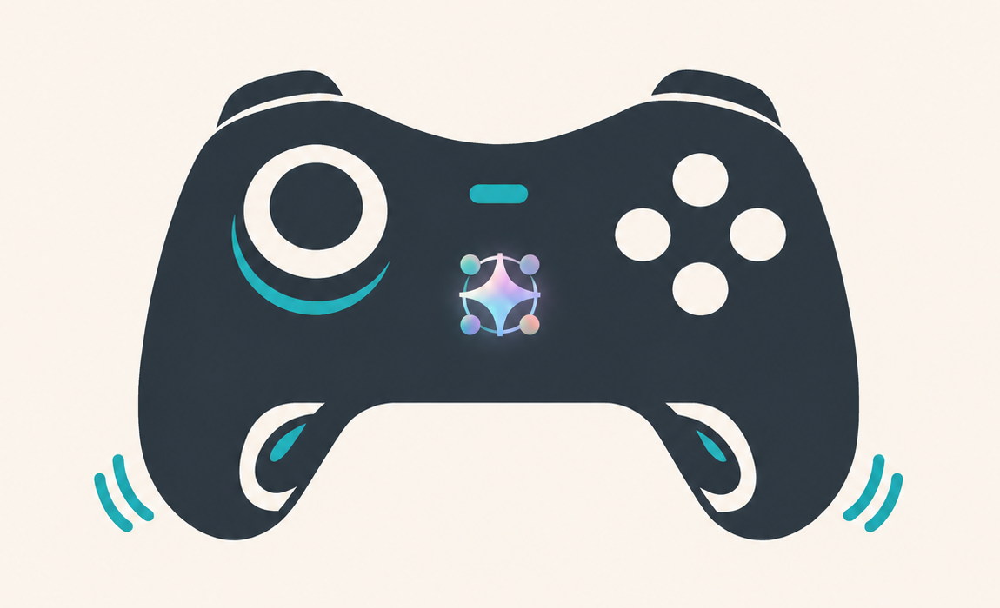
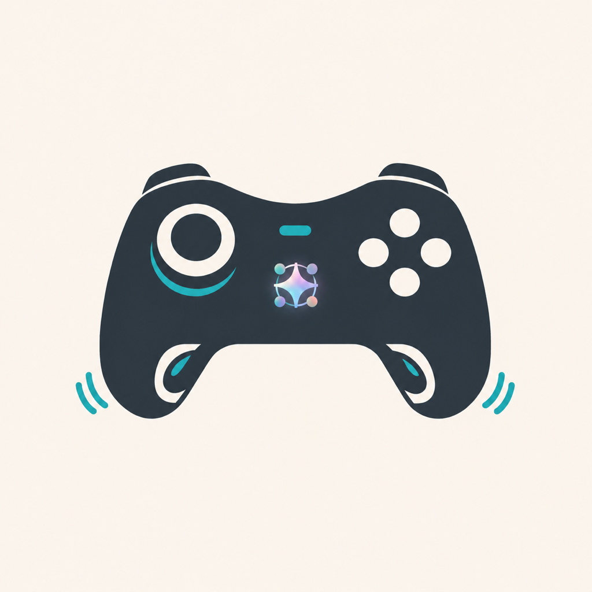
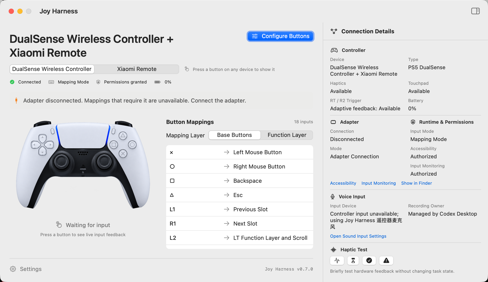
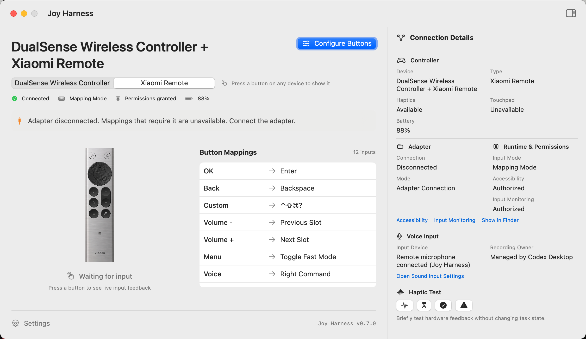

<p align="center">
  
</p>

<h1 align="center">Joy Harness</h1>

<p align="center">
  
</p>

Joy Harness 是一套面向 macOS Codex Desktop 的实体控制方案。它把 PS5 DualSense、Xbox
等被 macOS `GameController` 框架识别的扩展型手柄，连接到鼠标与系统快捷键、六个 Codex
Micro 任务槽、权限审批和按住说话，并提供操作确认震动与本地诊断界面。

这套方案由两部分组成：

1. **Joy Harness macOS 应用**：读取手柄输入、控制鼠标、播放震动，并提供控制器与输入状态 Dashboard。
2. **RP2040 固件**：让一块 Raspberry Pi Pico 兼容板在 USB 侧模拟 Codex Desktop 能识别的
   `Codex Micro`，再通过串口接收 Joy Harness 转发的手柄操作。

手柄和 RP2040 都连接 Mac，二者之间**不需要接线**。Joy Harness 会启动一个只读的 Codex
app-server 子进程获取任务名称和顺序，但不代理 Codex 操作，也不通过键盘模拟 Codex Micro；
任务槽、审批、按住说话等操作最终都由 RP2040 的原生 Vendor HID 接口送入 Codex Desktop。
鼠标、回车、复制、粘贴和截图等系统操作则直接发送给当前前台应用。

## 下载

当前版本为 **v0.9.0**，支持 Apple Silicon（arm64）和 Intel（x86_64，也称 AMD64）Mac，均要求 macOS 13.0 或更高版本。请按 Mac 的芯片选择下载：

- Apple Silicon：[下载 Joy-Harness-v0.9.0-macOS-arm64.dmg](https://github.com/nixihz/JoyHarness/releases/download/v0.9.0/Joy-Harness-v0.9.0-macOS-arm64.dmg) · [SHA-256 校验文件](https://github.com/nixihz/JoyHarness/releases/download/v0.9.0/Joy-Harness-v0.9.0-macOS-arm64.dmg.sha256)
- Intel：[下载 Joy-Harness-v0.9.0-macOS-x86_64.dmg](https://github.com/nixihz/JoyHarness/releases/download/v0.9.0/Joy-Harness-v0.9.0-macOS-x86_64.dmg) · [SHA-256 校验文件](https://github.com/nixihz/JoyHarness/releases/download/v0.9.0/Joy-Harness-v0.9.0-macOS-x86_64.dmg.sha256)
- [查看 v0.9.0 Release](https://github.com/nixihz/JoyHarness/releases/tag/v0.9.0)

DMG 只包含可手动启动的 `Joy Harness.app`。如需本地 CLI，或需要构建和刷写 RP2040 固件，
请使用下方的[源码安装](#从零安装)。签名与 Apple 公证信息请查看 Release 说明。使用对应架构的校验文件验证下载：

```bash
# Apple Silicon
shasum -a 256 -c Joy-Harness-v0.9.0-macOS-arm64.dmg.sha256
# Intel
shasum -a 256 -c Joy-Harness-v0.9.0-macOS-x86_64.dmg.sha256
```

## 界面预览

**DualSense 手柄**



**小米 RC003-MS 遥控器**



## v0.9.0 更新

- 新增可选的 Codex 光缝：同步六个原生 Micro 任务槽，支持保存屏幕边缘位置、调整亮度和点击打开任务。灯效同步需要更新到支持 HID Feature Report 7 的 Joy Harness RP2040 固件。
- 顶部光缝新增四种完成特效、随机特效选项和无需设备的预览，并遵循外观及系统减少动态效果设置。
- DualSense 使用专属默认映射：十字键发送方向键，Options 按住右侧 Command，L2 + × 关闭当前标签页或窗口（`⌘W`）；所有内置及自定义 Harness 通用，保留已自定义的映射。
- 从 rollout 事件恢复 Codex 任务状态；震动反馈仅在明确触发时播放有限时长的效果。
- 同时构建、签名和公证 Apple Silicon 与 Intel 原生版本，各自使用独立的 Sparkle 更新源。

## v0.8.2 更新

- 新增自定义应用 Harness，使用应用原生图标，独立保存按键映射，并可在设置中管理应用。
- Dashboard 改用玻璃卡片，连接详情按需展开，并自动滚动到刚按下的输入项。
- 在设置中切换当前 Harness 时保留窗口焦点；在 PS/Home 切换浮层中确认后打开或激活对应应用。
- 通过优化图片资源、精简应用包和改进压缩，将 macOS DMG 从约 18 MB 缩小至约 3 MB。

## v0.8.1 更新

- 防止 App Nap 降低后台手柄指针与滚动输入的更新频率，同时保留系统空闲休眠。
- 修正手柄横向滚动方向。
- 在 Dashboard 出现前保留系统默认的窗口重新打开行为。
- 发布验证为 Sparkle 更新源的传播预留等待时间。

## v0.8.0 更新

- 新增 Codex、Claude、Cursor、Antigravity 与 Joy Harness 主窗口的 Harness 切换浮层，支持独立映射和前台应用关联。
- 支持多个设备同时连接，Dashboard 新增设备切换器，并自动跟随最近按键的设备。
- 为签名并公证的稳定版加入 Sparkle 应用内更新，提供手动检查和可选的自动检查；下载与安装仍由用户确认。
- 源码、调试、ad-hoc 和预发布构建不进入稳定版更新源。

请先手动安装 v0.8.0，此后才能通过 Sparkle 接收应用内更新。

## v0.7.0 更新

- 标准游戏手柄与小米 RC003-MS 遥控器可同时保持连接，各自使用独立输入会话，并可选择要编辑的映射配置。
- Dashboard 使用固定 744 x 600 工作区，新增按需展开的连接详情侧栏，以及跟随系统、日间和夜间三种外观设置。
- 修复小米遥控器映射按键同时泄漏原始反引号或 F5 的问题，并覆盖延迟发现、重连和原生模式切换。
- 小米遥控器的映射、应用目标和录制快捷键与标准手柄独立保存，升级或重连后不会互相覆盖。
- 语音键松开后会完成缓冲音频再释放按住说话；断连、停用或切换原生模式时立即清理。

## v0.6.1 更新

- 修复下载版启动即崩溃：资源定位不再依赖构建机器目录。
- 发布前从临时目录中的应用实际加载版本和控制器图片，阻止资源缺失的包发布。

## v0.6.0 更新

- 重做控制器 Dashboard：采用紧凑的 744 × 600 布局，展示设备图、实时输入反馈、逐项按键映射和可展开的连接详情。
- 新增小米蓝牙遥控器 2 Pro（RC003-MS）支持，提供通过内置麦克风组件实现的语音输入和音量控制。
- 六个任务槽均支持配置全局快捷键。
- 修复错位排列显示器之间的指针移动、重复 Joy-Con HID 快照、类型化控制器动作处理及应用资源打包问题。

## v0.5.1 更新

- 当与显示刷新同步的指针时钟停跳或显示器配置发生变化时，自动恢复手柄指针移动。
- 缩短手柄指针响应时间，并合并重复的 Joy-Con 输入刷新，降低双手柄组合模式延迟。
- 修复本地运行目录尚未创建时首次启动失败的问题。

## v0.5.0 更新

- 手柄指针移动改为与显示刷新同步，并能稳定应对主线程阻塞、显示器切换和短时调度延迟。
- 强化本地 I/O、Codex 进程恢复、生命周期清理、状态时效、手柄映射迁移和 RP2040 传输缓冲。
- 修复快捷键松开后修饰键状态残留、影响后续手柄鼠标点击的问题。
- 新增 CI 与发布共用校验、协议文档，并显著扩充回归测试覆盖。

完整历史版本日志请参见 [CHANGELOG.zh-CN.md](CHANGELOG.zh-CN.md)。

## v0.4.0 更新

- 新增对 Nintendo Switch 第一代 Joy-Con 手柄的完整支持，包括单只 Joy-Con（L/R）横握/竖握、双持成对组合、任天堂物理键位标签、IOHID 物理侧键（SL/SR）消歧与 6 轴 IMU 运动数据解析。
- 新增原生手柄模式（Native Mode），支持在前台游戏应用（如 JoyDSH 等）激活时自动切换并暂停映射，支持通过手柄 PS / Home 键快速切换模式。
- 设置中新增普通、快速和慢速鼠标灵敏度的独立调节滑块与持久化存储。
- 新增多手柄并发触觉振动反馈支持，并在仪表盘中提供实时手柄按键高亮展示。

## v0.3.0 更新

- 新增可录制键盘快捷键，支持组合修饰键和可选映射备注。
- 手柄鼠标按键现在支持系统原生双击和三击行为。
- DualSense / DualShock 触控板按键默认改为鼠标左键，按住说话仍可作为自定义映射使用。

## v0.2.5 更新

- 修复手柄指针越过屏幕边缘后坐标继续漂移，导致光标要很久才能拉回来的问题。

## v0.2.4 更新

- 新增按住 `L3` 临时加速指针，以及 DualSense / DualShock 触控板精细指针控制。
- 移除旧 LaunchAgent 生命周期；登录时启动改由应用设置统一管理。
- Dashboard 与设置窗口采用更紧凑的 macOS 原生标题栏，并清理多余选中框和顶部留白。
- GitHub Release 工作流新增 Developer ID 签名与 Apple 公证。

## v0.2.3 更新

- `LT / L2 +` 右摇杆四向可自定义；默认左/右为网页上一页/下一页（`Command-[` / `Command-]`）。
- 新增“打开应用…”映射，可为按键选择具体 App。
- 设置中可为 `LT / L2 +` 左摇杆滚动选择自然滚动或传统滚动。
- 按住 `L3` 临时加速鼠标到 `1.8x`。
- DualSense / DualShock 触控板滑动可慢速移动指针，无需按住修饰键。

## v0.2.2 更新

- 设置入口更清晰，通用设置支持登录时启动。

## v0.2.1 更新

- 修复从 GitHub 下载的 Release 版本启动时，因为已经从应用资源读取版本号后仍立即加载
  SwiftPM 资源 bundle 而导致的崩溃。

## v0.2.0 更新

- 新增 `LT + RT` 回车、`LT + L3/R3` 复制/粘贴，以及 Options/View 飞书截图快捷键。
- 控制台改为更紧凑的三栏布局，并统一展示应用版本和链路健康状态。
- 应用版本集中由 `VERSION` 资源管理，应用、安装脚本和 DMG 使用同一个版本号。
- Xbox RT 提供 Impulse Trigger 分级反馈；DualSense R2 使用自适应扳机阻力墙。
- 简体中文和 English 界面可跟随系统，也可在设置中手动切换。

## 能达到什么效果

安装完成后，可以获得以下能力：

- **离开键盘操作 Codex**：用手柄在六个 Codex Micro 任务槽之间切换、打开当前任务、
  批准或拒绝权限请求，以及输入 `yes` / `no`；Fast 模式和拆分任务仍可配置为自定义映射。
- **按住说话**：Xbox Menu / DualShock Options 默认发送 Codex Micro `ACT10`，松开时结束。录音仍由
  Codex Desktop 原生完成；DualSense 没有默认按住说话键，Options 为右 Command，触控板按键为鼠标左键，可在设置中明确改映射。
- **独立 AI 语音（本轮实现）**：在“设置 → AI 语音”明确启用并配置模型后，按住 DualSense 的 L2，短点 PS 后立即松开 PS，看到聆听提示后继续按住 L2 说话，松开 L2 执行已登记能力；普通 PS 始终按下立即打开 Harness 切换浮层。默认使用 Apple 设备端识别和用户自己的本机模型 API；详见下方配置说明。
- **DualSense 语音诊断**：检测通过 USB 暴露的手柄麦克风，并提示它是否已被设为 macOS
  默认输入；诊断不改动全局声音设置。独立 AI 语音启用后在 L2 + PS 发起的会话中使用系统默认麦克风。
- **DualSense R2 强反馈**：R2 轻触时给一次轻震，中段形成明显阻力墙，完全按下越过触发点
  时释放阻力并补一次短促强震，形成分级的操作确认。
- **用手柄控制 macOS**：左摇杆移动鼠标，右摇杆滚动；双摇杆手柄按住 LT/L2/ZL 或 L3 加速，单只 Joy-Con 仍用功能层键 + 摇杆滚动；DualSense/DualShock 触控板滑动可精细瞄准；A/B 负责左右键，R3 负责
  中键，X/Y 负责 Backspace 和 Esc；LT 功能层还提供回车、复制和粘贴。
- **管理六个任务槽**：LB/RB 顺序切换，或用 LT 组合键直接跳到 1–6 号槽位；切换后以
  对应次数的短震确认当前槽号。
- **全局键盘槽位快捷键**：在“设置 → 槽位快捷键”中为六个槽位分别录制或清除快捷键，默认不设置；修改自动保存并立即生效，应用在后台时同样可用。需要应用保持运行并连接 RP2040，无需连接手柄。
- **可视化诊断**：macOS 控制台展示当前槽位、手柄电量与震动能力、
  RP2040 连接状态以及辅助功能授权状态，并可打开当前任务。
- **原生手柄模式（直通模式）**：切换到指定应用（如 JoyDSH、Steam 或独立游戏）时自动暂停 Joy Harness 模拟鼠标与按键映射，让目标应用直接接收原生手柄事件，离开时自动恢复；如需手动切换，可为按键分配 **切换原生/映射模式**（小米遥控器的菜单键默认如此），切换时伴有触觉反馈。手柄的 **PS / Home** 键在映射模式下呼出 Harness 切换浮层，在原生手柄模式下返回映射模式。
- **自定义按键**：在应用的“设置”中为基础按键、十字键和 LT 功能层分别选择鼠标、
  系统、Codex Micro、槽位控制或禁用操作；修改即时生效并自动保存。
- **小米 RC003-MS 遥控器**：通过 macOS IOHID 直接识别 Xiaomi Bluetooth Remote 2 Pro，
  支持确认、返回、菜单、语音、主页、十字键、音量和自定义键；控制台使用专用遥控器图并实时高亮按键。
- **中英文界面**：默认跟随 macOS 首选语言，中文系统显示简体中文，其他语言显示英语；
  也可在应用“设置”中手动固定为简体中文或 English，选择会自动保存。
- **后台运行**：可在设置中启用登录时启动；应用运行期间，手柄或 RP2040 中途断开、
  重新连接时会自动重新检测。

### 不同硬件组合的能力

| 当前条件 | 可以使用的能力 |
|---|---|
| 只有 Joy Harness 应用 | 查看控制台和本地状态，使用 CLI 进行诊断 |
| 应用 + 手柄 | 鼠标、滚动、系统按键、槽位确认震动和手动震动测试 |
| 应用 + RP2040 | 通过全局键盘快捷键选择 Codex Micro 任务槽，或通过控制台选择、打开任务槽；无手柄时不能使用手柄审批操作 |
| 应用 + 手柄 + RP2040 | 完整体验：手柄控制 Codex、鼠标操作、按住说话和操作确认震动 |

## 工作原理

```text
Joy Harness macOS 应用 ── Core Haptics ──▶ 手柄震动
        ▲
        │ GameController
        └────────────────────────────────── DualSense / Xbox / 兼容手柄

手柄操作 ──▶ Joy Harness ── USB CDC 串口 ──▶ RP2040
                                                │
                                                │ Vendor HID
                                                ▼
                                   Codex Desktop / Codex Micro

左摇杆、A/B/X/Y、R3 ──▶ Joy Harness ── CoreGraphics ──▶ macOS 前台应用
```

RP2040 固件同时暴露两个 USB 接口：

- `Codex Micro` Vendor HID：由 Codex Desktop 读取，传递任务槽、审批、按住说话和径向输入。
- `Joy Harness Bridge` USB CDC 串口：由 Joy Harness 使用，负责把手柄事件发送给 RP2040。

Joy Harness 只有在串口收到兼容握手 `READY agentdeck-rp2040` 后才认为桥接成功，因此不会
把其他 USB 串口设备误识别为 RP2040。握手名称保留旧项目名是为了兼容已经刷入的固件。

## 开始前的准备

### 源码安装所需软件

直接下载 DMG 使用时不需要 Xcode、Python 或 Git。只有从源码安装、使用 CLI 或构建固件时
才需要下列工具。

| 项目 | 要求 | 用途 |
|---|---|---|
| macOS | 13.0 或更高 | SwiftUI、GameController、Core Haptics 和辅助功能接口 |
| Codex Desktop | 支持 Codex Micro 的版本 | 接收 RP2040 Vendor HID 输入 |
| Xcode Command Line Tools | 提供 Swift 5.9+ 和 macOS SDK | 编译 Joy Harness macOS 应用 |
| Python | Python 3 | 运行本地状态与诊断 CLI |
| Git | 可访问 GitHub | 首次构建固件时自动下载 Pico SDK 2.2.0 |

可以先检查本机环境：

```bash
xcode-select -p
swift --version
python3 --version
git --version
```

若没有 Xcode Command Line Tools：

```bash
xcode-select --install
```

### 完整体验所需硬件

只使用鼠标、系统快捷键、控制台和手动震动时，可以不连接 RP2040；要控制 Codex Micro
任务槽、审批和按住说话，则需要完整硬件链路。

- 一台运行 macOS 的 Mac。
- 一只可被 macOS `GameController` 框架识别的手柄，或一只已经配对为 HID 设备的 Xiaomi
  Bluetooth Remote 2 Pro（`RC003-MS`）。项目原生适配 PS5 DualSense、PS4 DualShock 4、
  Xbox Series、初代 Joy-Con L/R 和 RC003-MS；其他手柄可使用标准按键、摇杆与十字键，具体能力取决于 macOS 暴露的输入与震动接口。
- 一块 RP2040 开发板，例如 Raspberry Pi Pico 或兼容板。
- 一根**支持数据传输**的 USB 线。只能充电的线无法刷写固件或创建串口/HID 设备。

手柄可以通过蓝牙或 USB 连接，但当前测试的 Xbox Series 手柄在 macOS 26.5.2 下只有
**蓝牙模式可以正常震动**；USB 模式虽可被系统识别，系统原生 Identify 也不会触发震动。
需要状态反馈时优先使用蓝牙。

多个被 macOS `GameController` 识别的手柄可以同时保持连接，小米 RC003-MS 遥控器也可以与
它们并行连接。Xbox、DualSense/DualShock 与遥控器各自拥有独立输入会话，连接其中一个设备
不会再主动断开或禁用其他设备。初代 Joy-Con 仍保留现有的组合优先级：检测到 Joy-Con 端点
时，Joy Harness 会优先展示左右成对或单支的逻辑 profile，直到 Joy-Con 断开。

初代 Joy-Con 需要分别通过蓝牙连接。Joy Harness 可将 L/R 组合为一只逻辑手柄，也支持左单支
或右单支。在主界面的“控制映射”区域可选择横握或竖握，左右单支分别保存方向与映射，双支模式
不受该方向设置影响。单端点优先读取经过校准的 HID 连续摇杆数据，避免 macOS 的 Direction Pad
将轻推和满推都报告成满幅值；优先使用用户校准，其次使用工厂校准，读取失败时采用默认值。
HID 采用竖握物理坐标，仅在横握时旋转；系统合成的双支 profile 保留 GameController 坐标。
单只 Joy-Con 竖握时，侧边 SL/SR 可独立映射，可在“设置 → 按键映射”中分别改绑。
左 Joy-Con 的 Codex 默认布局如下（已有自定义配置保留，可恢复默认应用）：

| 按键 | 功能 | 按住 ZL 时 |
|---|---|---|
| 推摇杆 | 移动鼠标 | 滚动页面 |
| 摇杆按下 L3 | 按住加速 | 回车（暂定） |
| L | 鼠标左键，按住拖拽 | 鼠标中键 |
| ↑ | Esc | 会话 1 |
| → | 鼠标右键 | 会话 2 |
| ↓ | 回车 | 会话 3 |
| ← | 退格 | 会话 4 |
| SL / SR | 上一个 / 下一个会话 | 沿用基础动作 |

ZL 为修饰键。Claude 下 SL/SR 使用 Claude 的前后会话快捷键，不发送 Codex 槽位操作。
右 Joy-Con 保持 SL 加速、SR 精细移动。横竖握共用逻辑键配置，横握 SL/SR 对应肩键输入。
修正后的鼠标输出、右单支、横握和双支仍待最终真机验收，因此暂时保留实验性标记。震动和 motion 仅在
macOS 实际暴露时可用。

RC003-MS 在 **系统设置 → 蓝牙** 中配对后，启动 Joy Harness 并观察控制台是否显示“小米蓝牙遥控器”。
默认十字键对应键盘上/下/左/右，确认回车、返回退格、主页 Esc，音量 −/+ 切换任务槽位，
语音键发送右侧 Command 供 Spokenly 按住录音，自定义键飞书截图。菜单键切换原生/映射模式。
可在“设置 → 自定义按键 → 恢复默认映射”应用完整布局，详见 [`DESIGN.md`](../DESIGN.md)。
如果使用 Karabiner-Elements，请在 Devices 中关闭这只遥控器的 Modify events，避免其独占 HID。
Joy Harness 需要“输入监控”授权；`./scripts/build_and_run.sh --logs` 可查看每次按下、松开对应的遥控器事件。
内置麦克风通过 ATVV 蓝牙语音协议直接接入 Joy Harness。在“设置 → 通用 → 遥控器麦克风”
启用应用自带的已签名驱动，再选择为系统语音输入；无需独立安装器或语音桥软件。首次安装需要管理员验证，
音频服务重载时声音会短暂中断。详见[遥控器麦克风说明](xiaomi-remote-voice.md)。
映射模式下，12 个已适配按键只执行 Joy Harness 映射，避免方向键、菜单和系统音量双重响应；其他键盘不受影响。
HID 事件服务延迟出现时会自动重试屏蔽；切换到原生模式或退出应用后恢复原有系统按键行为。
遥控器映射、应用目标与录制快捷键独立保存，断连重连后继续使用。首次 HID 打开失败时，
授予输入监控权限后可通过 Dashboard 的重新扫描重试。可运行 `python3 scripts/verify_xiaomi_remote_volume.py`
按提示进行实机回归，自动检查按键事件和系统音量。

保持刚构建的 App 正在运行，然后按实际硬件场景执行对应的摇杆到鼠标方向验证：

```bash
./scripts/verify_joycon_pointer.sh left-horizontal
./scripts/verify_joycon_pointer.sh left-vertical
./scripts/verify_joycon_pointer.sh right-horizontal
./scripts/verify_joycon_pointer.sh right-vertical
./scripts/verify_joycon_pointer.sh pair
```

验证器会先检查当前 Joy-Con 模式，再依次测量实体上、右、下、左造成的鼠标位移。双支模式只验证
左 Joy-Con 摇杆，因为右摇杆负责滚动，不控制鼠标。

DualSense 的标准按键、触控板按键和震动由 Apple 的 `GCDualSenseGamepad` / Core Haptics
接口支持。使用现有系统音频路径时，应通过支持数据传输的 USB 线连接手柄麦克风，并在“系统设置 →
声音 → 输入”中选择 `DualSense Wireless Controller` 或 `Wireless Controller`。这里的
`Wireless` 是产品名，不代表音频正在走无线；Joy Harness 会另外显示真实的 `USB` 传输。
仅在 macOS 中蓝牙配对不会发布手柄麦克风音频设备。源码现已加入独立的蓝牙系统音频桥，
但真实无线录音及 Codex 的 M0 验收尚未完成，入口仅在[开发验证预览](#dualsense-无线系统麦克风开发验证)中显示，
不能据此将蓝牙收音视为已正式支持。现有无线控制仍可通过已配置的按住说话映射触发 Codex，
录音输入继续选择 Mac 内置麦克风、AirPods 或其他音源；控制台会显示当前系统默认输入。
DualSense 的实体静音键没有公开的 GameController 事件，是否静音由手柄固件和系统音频设备
自行管理。

DualSense 的 R2 使用系统公开的自适应扳机接口：进入约 8% 行程时先轻震一次，前 35% 为
自由行程，35%–72% 提供最高 90% 的阻力，越过 72% 后突然释放并触发一次强震。快速直接
按到底时会跳过轻震，避免反馈重叠；松开到 18% 以下会重新待命。此反馈只在
DualSense 上启用，不改变 Xbox、DualShock 4 或通用手柄的 RT/R2 输入行为。Xbox 的 RT
使用 Impulse Trigger 细微震动：进入约 8% 行程时轻触提示一次，越过 72% 并向 Codex Micro
发送 `ACT12` 时再确认一次；松开到 18% 以下后重新待命。macOS 暴露 `.rightTrigger` locality
时反馈只在 RT 马达播放，否则回退为更轻的全手柄震动。macOS 会在
Joy Harness 退到后台时关闭 GameController 的扳机效果；USB 或蓝牙连接的 DualSense 会
通过对应的原始 HID 输出自动恢复，因此在 Codex Desktop 前台也能保持阻力。R2 反馈跟随
已连接的 DualSense，不会因为当前映射配置页选中了小米遥控器而被关闭。

### 构建 RP2040 固件所需工具

固件构建脚本使用 CMake、Ninja 和 ARM GCC。使用 Homebrew 安装：

```bash
brew install cmake ninja arm-none-eabi-gcc
```

`task` 只是项目命令的快捷入口，不是硬性依赖：

```bash
brew install go-task
task --version
```

不安装 `task` 也可以直接运行每一节列出的 Bash 脚本。

### 需要授予的系统权限

| 权限 | 授权对象 | 影响 |
|---|---|---|
| 辅助功能（Accessibility） | Joy Harness | 允许发送鼠标、回车、复制、粘贴、截图和其他系统按键 |
| 输入监控（Input Monitoring） | Joy Harness | 允许应用退到后台后继续接收手柄输入 |
| 输入监控（Input Monitoring） | Codex Desktop | 允许 Codex Desktop 接收 Codex Micro 的物理输入 |
| 麦克风 | Codex Desktop | 使用 Codex 原生按住说话时，由 Codex Desktop 管理录音权限 |
| 麦克风 | Joy Harness | 独立 AI 语音、遥控器虚拟麦克风需要；外部录音应用使用 DualSense 时需自己的麦克风权限；在对应设置区检查授权，启动时不会隐式请求 |
| 语音识别（Speech Recognition） | Joy Harness | 本地／混合路线使用 Apple 设备端识别需要；不可用时不自动改为云端识别 |

权限位置通常在“系统设置 → 隐私与安全性”。没有辅助功能权限时，Codex Micro 操作和震动
仍可工作，但鼠标和所有系统快捷键不会生效。

## 从零安装

以下命令均在项目根目录执行。

### 1. 构建并刷入 RP2040

最简单的方式是把这个仓库链接复制到 Codex：

<https://github.com/nixihz/JoyHarness>

然后告诉它：

> 帮我把这个仓库里的 RP2040 固件刷入开发板。

Codex 会自行决定如何读取仓库，参考其中的说明和脚本，并在需要操作实体设备时提示你。
请使用支持数据传输的 USB 线连接 RP2040，然后按提示操作。

本仓库只提供并支持自带的 RP2040 固件。使用其他微控制器时，可以让 Codex 参考这里的实现，
但适配、构建和刷写工作需要自行开发完成。

如需手动构建和刷写，请执行：

```bash
task firmware
# 不使用 task：bash scripts/build_rp2040_firmware.sh
```

首次执行会把 Pico SDK 2.2.0 下载到 `~/.agent-deck/toolchains/pico-sdk`，固件产物位于：

```text
firmware/rp2040/build/joy_harness_rp2040.uf2
```

按住开发板上的 `BOOTSEL` 键，将 RP2040 插入 Mac。Finder 中出现 `RPI-RP2` 磁盘后执行：

```bash
task flash
# 不使用 task：bash scripts/flash_rp2040_firmware.sh
```

UF2 文件复制完成后，RP2040 会自动重启并退出磁盘模式。

默认按 Raspberry Pi Pico 构建。如果兼容板需要其他 Pico SDK 板型：

```bash
PICO_BOARD=<board-name> task firmware
```

已有 Pico SDK 时可避免重复下载：

```bash
PICO_SDK_PATH=/absolute/path/to/pico-sdk task firmware
```

### 2. 从源码安装 Joy Harness

```bash
task install
# 不使用 task：bash scripts/install.sh
```

安装脚本会编译、安装并启动 release 应用。从旧版升级时，脚本还会移除 Joy Harness 旧的
Codex hooks 和 `notify` fan-out，但会保留其他工具的 Hook 和通知配置。
需要登录时启动时，可在应用的“通用”设置中开启；主动退出应用后不会自动重启。
部署或开发启动前会按完整应用路径停止所有旧 Joy Harness / AgentDeck 实例，确认退出后再启动
唯一的新实例，避免多个应用争抢手柄和 Unix socket。应用本身也持有跨副本的进程锁；即使
从其他目录手动打开旧副本，后启动的实例也会立即退出。

### 3. 连接设备并重启 Codex

1. 通过蓝牙或 USB 连接手柄；Xbox 震动优先使用蓝牙，DualSense 内置麦克风使用 USB。
2. 保持刷好固件的 RP2040 通过数据线连接 Mac。
3. 完全退出 Codex Desktop 后重新打开，让它重新扫描 `Codex Micro` HID 设备。
4. 在系统设置中给 Joy Harness 授予辅助功能权限，给 Codex Desktop 授予输入监控权限。

### 4. 验证安装结果

查看运行状态：

```bash
task status
# 或：cat ~/.agent-deck/status.json
```

完整链路正常时，至少应看到：

```json
{
  "accessibility": true,
  "haptics": true,
  "mode": "physical-codex-micro",
  "rp2040": true
}
```

其中 `haptics: false` 只表示当前手柄没有可用的 Core Haptics 引擎，不影响普通按键输入；
`accessibility: false` 不影响 RP2040/Codex Micro 操作，但会禁用鼠标和系统按键。
控制台的“语音输入”会显示检测到的 DualSense 音频设备，并标记它是否为系统默认输入。

测试单个震动状态和完整震动序列：

```bash
~/.agent-deck/bin/joy-harness-send waiting
task demo
```

最后在 Codex Desktop 中打开一个任务，依次验证：

1. 按 `LT + A` 批准，或按 `LT + B` 拒绝。
2. 使用 LB/RB 切换任务槽，并通过短震次数确认槽号。
3. 按住 Menu/Options 使用 Codex Desktop 的原生按住说话。

## Harness 应用管理

在 **设置 → Harness → 添加应用** 中浏览 `.app`，或从运行中的应用选择。新增应用会进入切换器，保留独立的按键映射，并在重启后恢复；重复添加同一应用会启用已有项，不覆盖映射。自定义应用可以停用或移除。

设置页直接管理应用，不需要额外关联应用或配置激活开关。“当前 Harness”下拉框只切换映射，不打开应用，也不移走设置窗口焦点；在 PS/Home 切换浮层中确认后始终打开或激活对应应用。前台应用唯一匹配某个 Harness 时会自动切换；无法唯一匹配时保留当前选择。自定义 Harness 默认使用通用鼠标和键盘操作，可在“按键映射”中继续配置。

## DualSense 无线系统麦克风

Joy Harness 自带已验证的 DualSense Audio 驱动。目前要求 Apple 芯片 Mac、macOS 26，以及“应用程序”中的 Xcode。

1. 通过蓝牙连接一只 DualSense。
2. 打开 **设置 → 通用 → PS5 手柄麦克风**，点击“启用手柄麦克风”或“更新／修复组件”，在系统弹窗完成管理员验证。系统声音会短暂中断。
3. 点击“设为系统麦克风”，或在录音应用中选择 **DualSense Microphone**；外部应用仍需要自己的麦克风权限。
4. 将 Options 映射为外部语音软件的切换录音快捷键：按一次开始，再按一次结束。升级保留自定义映射；内置 AI 继续使用 L2＋PS 的独立入口。

Game Mode 随实际采音开启，所有消费者停止后恢复原策略。系统声音设置的输入电平表也会采音。无需手动供音或管理独立驱动软件；同一区域可卸载，普通手柄控制与小米麦克风保留。更新会移除旧 **Joy Harness DualSense 麦克风** 输入，并保留小米的设备身份。RP2040 无需刷固件。

真人音质已有用户正向反馈；Options 与 AI 的完整实体交互验收单独记录。实现与验证边界见[系统麦克风规格](specs/dualsense-bluetooth-microphone.md)。

## 独立 AI 语音

独立语音是 Joy Harness 自己的命令入口。用户已反馈当前环境基本功能打通，例如打开微信输入法设置；新增能力仍按设备与服务分别验证。它与 Codex Micro 的 `ACT10` 按住说话、小米遥控器的虚拟麦克风桥分别工作，不要求把语音注入当前聊天框。

在 **设置 → AI 语音** 中配置：

1. 默认处理方式是 **本地**：Apple 设备端语音识别，加本机 OpenAI Chat Completions 兼容模型服务。先启动你自己的模型服务，再填写 API 基础地址和实际模型名称。示例地址默认是 `http://127.0.0.1:1234/v1`，不表示该端口已经有服务；模型名称默认空，未填写时不会发起请求。
2. API Key 可以留空；服务需要鉴权时填写并保存到钥匙串。Joy Harness 不自带模型、不自动下载模型，也不复用 Codex／Claude 账户。
3. 确认当前系统默认麦克风与识别语言。点击“选择系统麦克风…”进入 macOS 声音设置；首版没有应用内独立设备选择器。使用“检查录音权限”完成麦克风及所需的语音识别授权。
4. 在“声音、显示器、应用与系统、媒体与查询”四组中查看示例，并按需要逐项开关能力。
5. 明确打开“启用 AI 语音”。该开关默认关闭，升级不会自动开启。等待服务和权限就绪，再使用手柄。

| 操作 | 结果 |
| --- | --- |
| 普通 PS，不论 AI 语音是否启用 | 按下立即打开 Harness 切换浮层，不录音。 |
| 启用后先按住 L2，再短点 PS | PS 按下即准备录音；立即松开 PS，看到“正在聆听，松开 L2 发送”后继续按住 L2 说话。 |
| 正常松开 L2 | 结束本次录音，识别并执行一次；松开 PS 不会发送。 |
| AI 语音关闭时 L2 + PS | 消费为空动作，不打开浮层、不录音；不会在松开时补发普通 PS。 |
| 录音时 B／Esc／取消 | 丢弃本次录音，之后松开 L2 或 PS 都不发送。 |
| 原生模式下 PS／已打开切换浮层时 PS／所选设备校准中 | 分别恢复映射／关闭浮层／交给校准消费；该次输入不会开始录音。 |

目前登记 **17 类能力**，在设置页逐项开关：

| 分组 | 可说的示例与范围 |
| --- | --- |
| 声音 | “声音大一点”“音量设为50%”“静音”“取消静音”“现在音量是多少”。 |
| 显示器 | “屏幕暗一点”“亮度提高20个百分点”“屏幕亮度设为60%”“屏幕亮度是多少”。 |
| 应用与系统 | 打开已安装应用、“打开当前应用的设置”、27 个固定系统设置页、微信输入法 **3.0.0** 设置、9 个常用文件夹及 macOS 截屏工具；“打开日间模式”“打开夜间模式”“跟随系统”控制 macOS 系统外观。 |
| 媒体与查询 | “切换播放暂停”“下一首”“上一首”“现在几点”“电脑还剩多少电”。 |

音量和亮度未指定幅度时调整 **10 个百分点**；“设为50%”使用绝对值。调大音量、设置大于 0 的音量会解除静音；单独“取消静音”保留原音量。亮度优先控制内建屏，没有内建屏则控制主屏。外接屏增加 DDC/CI 硬件调光，当前限单块物理外接屏且控制通道唯一的连接；不支持时会说明原因。Redmi 27 NU 已验证真实亮度读取，实际写入效果仍待试用；每次修改均读回核对。

“打开系统设置”能力可打开 Wi-Fi、蓝牙、声音、显示器、隐私与安全性、软件更新等固定页面，仅打开页面，不修改其中的选项。常用文件夹包含个人文件夹、桌面、下载、文稿、应用程序、系统实用工具、图片、影片和音乐；完整设置页与参数见[能力目录](specs/joy-harness-ai-voice.md#7-可扩展能力约定)。

说“打开当前应用的设置”，会向**提交语音时的前台应用**发送一次 `⌘,`。后续追问沿用首次提交的目标，不会改为回答时正在使用的另一个应用。语音浮层不会抢走前台焦点；等待识别和理解时，请保持目标应用在前台。如果执行前已切换应用、目标应用已退出或缺少辅助功能权限，Joy Harness 会说明未发送，不切回应用，也不重复发送。结果只表示设置快捷键已发送，尚未确认设置窗口是否打开，部分应用可能不支持此快捷键。它与“打开系统设置”和“打开微信输入法设置”是不同能力；本轮验证记录见规格 v0.7。

系统外观是独立能力：说“打开日间模式”将 **macOS 设为浅色**，说“打开夜间模式”设为 **macOS 深色**，说“跟随系统”或“自动外观”则启用 **macOS 按时间自动切换**。日间／夜间会先关闭自动切换；自动模式由 macOS 决定当前颜色，读回设置符合请求后才报告成功。Joy Harness 自身的主题选项保持不变，原本选择“跟随系统”时会自然变色。该能力不控制 Night Shift／夜览或硬件亮度；说“打开外观设置”仍只是打开系统设置页。新增外观能力已通过自动化、安装与只读环境验证，真实切换的验证边界见规格 v0.6。

媒体播放／暂停只能**切换**，因此单说“暂停”或“播放”会先说明并追问，不能保证执行后变成指定状态。若出现“切换播放／暂停”按钮，点选即可执行一次，也可以重新说“切换播放暂停”；单说“确认”不会直接发送切换。截屏能力只打开系统工具，由你选择区域并完成截屏。电量查询只读 Mac 内置电池，桌面机无内置电池时如实说明，不查询手柄或耳机电量。

每次执行一项能力；一句话要求多项操作时先询问做哪项。目标不明确、未安装或设备不支持时会提示原因；媒体按键已发送、目录或工具打开请求被接受，也可能显示“尚无法确认”。结果约 **3 秒**后收起。

用户实测持续按住 PS 会导致手柄关机，旧 PS 长按语音方案已废除；新方案没有 0.6 秒等待，只短点 PS，随后只保持 L2。当前用户环境已有基本可用反馈，其他型号与连接方式仍需分别验收。 L2 + PS 也会取消该次体感快速定位，松开 L2 不再移动光标。

组合录音要求单只可唯一关联的 DualSense 和连续可信的原始 HID 报告。连接多只 DualSense、无法对应设备身份或原始报告不可用时，不开放组合录音，保留普通 PS 的即时切换行为。手柄可用 USB 或蓝牙传送按键；此入口没有直接接入蓝牙手柄 PCM，仍使用 Mac、耳机等系统默认输入。USB 手柄只有被系统实际识别为音频输入并选为默认时才用于录音。上方的系统麦克风开发预览独立供音，不因开启 AI 语音而自动启动，当前不作为内部语音的蓝牙收音支持证明。

默认路线要求设备端识别可用，不支持的设备／语言会显示阻断，不静默改用云端。**本地 API 地址不保证服务也在本地处理**：若本机网关继续转发到云端，转写仍会离开电脑。需要自行确认所配置服务的数据去向。

用户可主动选择 **混合**（设备端识别、转写发送到指定模型服务）或 **云端**（松开 L2 后上传音频到指定识别服务，再将转写发送到模型服务），分别配置端点与模型；远程端点使用 HTTPS。Joy Harness 不自动切换路线，不持续监听，不保存录音文件或转写历史；服务方是否留存由所选服务的政策决定。录音期间输入设备变化、断连、中断或达到 60 秒上限时取消，不自动发送。

实现与验收边界见 [AI 语音规格](specs/joy-harness-ai-voice.md)。

## 手柄按键与实际效果

可以从 macOS 菜单栏打开 `Joy Harness > 设置`，或点击控制映射区域的齿轮按钮，自定义每个
数字按键和 LT 组合键。设置保存在当前用户的偏好设置中；“恢复默认映射”可还原下表行为。
同一设置窗口顶部可以选择“跟随系统”“简体中文”或 `English`；手动选择会覆盖系统语言。
Options / View 依赖驱动暴露对应事件。DualSense 的 PS 与 L2 同时有原始 HID 入口；组合录音只使用该可靠输入链路，其他手柄 Home 保留原有行为。

任意可映射输入都可以选择“录制按键…”。点击“点击录制”后，在键盘上按下单键或包含
`Command`、`Control`、`Option`、`Shift`、`Fn` 的组合键；还可以填写备注说明用途。录制结果和
备注会随映射一起保存在当前用户的偏好设置中，触发时发送给当前前台应用，并需要辅助功能权限。

### 鼠标和系统控制

| 按键 | 实际效果 | 是否需要辅助功能权限 |
|---|---|---|
| 左摇杆 | 以 120Hz 平滑移动 macOS 鼠标，带死区和渐进加速 | 是 |
| DualSense / DualShock 触控板滑动 | 慢速相对移动指针，适合精细瞄准；无需按住任何修饰键。触控板按下仍走映射（默认鼠标左键） | 是 |
| 右摇杆 | 上下纵向滚动、左右横向滚动，所有 Harness 通用，无需按键；可与左摇杆移动鼠标同时进行。摇杆幅度控制速度，可在设置中选择自然滚动或传统滚动 | 是 |
| 按住 LT / L2 / ZL + 左摇杆 | 双摇杆手柄使用快速灵敏度移动指针（默认 `1.8x`），与 L3 共用设置，加速不叠加 | 是 |
| 单只 Joy-Con：功能层键 + 摇杆 | 上下纵向滚动、左右横向滚动，摇杆幅度控制速度；可在设置中选择自然滚动或传统滚动 | 是 |
| L3 按住 | 临时使用可配置的快速灵敏度（默认 `1.8x`），松开恢复普通灵敏度 | 是 |
| A 按下 / 松开 | 鼠标左键按下 / 松开，可单击、长按或拖动 | 是 |
| B 按下 / 松开 | 鼠标右键按下 / 松开，可右击或拖动 | 是 |
| R3 按下 / 松开 | 鼠标中键按下 / 松开 | 是 |
| X | Backspace；按住后按系统节奏连续删除 | 是 |
| Y | Esc | 是 |
| Xbox：LT + RT；PlayStation：L2 + R2 | 普通回车（Enter） | 是 |
| LT + L3 | 复制（`Command-C`） | 是 |
| LT + R3 | 粘贴（`Command-V`） | 是 |
| DualSense（PS5）：L2 + × | 关闭当前标签页或窗口（`Command-W`），具体由前台应用决定；所有内置及自定义 Harness 通用 | 是 |
| LT + 右摇杆 左 / 右 | 网页上一页 / 下一页（`Command-[` / `Command-]`） | 是 |
| LT + 右摇杆 上 / 下 | 默认空白；可在设置中自定义为打开指定应用或其他操作 | 取决于所选操作 |
| Xbox：Options / View；PlayStation：Create | 飞书截图（`Command-Shift-A`） | 是 |
| 十字键上按下 / 松开 | 右侧 Command 按下 / 松开；默认用于唤起按住说话类语音输入工具 | 是 |

这些操作发给当前前台应用，不只限于 Codex Desktop。“功能层”默认绑定 LT（PlayStation 为 L2，Joy-Con Pair 为 ZL）：双摇杆手柄按住时，左摇杆使用与 L3 相同的快速灵敏度移动指针，加速不叠加；L3/R3 仍执行复制/粘贴，LT + 右摇杆左/右仍执行网页上一页/下一页。
按住功能层键时，右摇杆停止滚动，改为触发四个方向的映射。单只 Joy-Con 继续用功能层键 + 摇杆滚动。Xbox 的 `Options / View`、PlayStation 的 `Create` 当前
默认单按触发飞书截图；如果手柄驱动未向 macOS 暴露该键，可在设置中把“飞书截图”改配到
其他按键。该功能要求飞书正在运行，并将截图快捷键设置为 `Command-Shift-A`。

DualSense 的 L2 + × 无需在每个 Harness 中单独配置。升级后，仍使用旧默认值的映射会自动补齐；即使设置当前选中的是 Joy-Con 或小米遥控器，PS5 手柄也会使用该默认值。已自定义的映射保留。

### DualSense 体感快速定位

开发版支持按住 **L2** 轻转手腕指向左上、右上、左下或右下，松开后将光标移到相应屏幕四分区的中心，再用摇杆或触控板微调。按下 L2 时光标所在的显示器决定本次落点；不会在整个多屏桌面上取四等分。

首次使用，在 **设置 → 通用 → 体感快速定位** 选择 DualSense，点击“录制我的手势”。先做一次普通 L2 按放，再朝四个方向各转腕一次，共五步。只要大致朝对应方向即可，不要求力度、速度和轨迹一致。有效参考齐全后，点击“应用校准”保存为个人默认并启用；也可以先测试手感，不要求一轮全对。哪个方向不顺就单独重录，其他方向会保留。录制使用传感器数据，不需要摄像头。

可在“调整手势阈值”中修改动作幅度、速度、时长和方向容差。修改只影响草稿，点击应用后才替换已保存配置；更改参数会清除过期测试结果。结束测试保留草稿，取消录制或离开设置不覆盖原配置。测试默认只移动预览标记；主动开启“测试实际定位”才会移动系统光标。

L2 必须映射为功能层。使用其他按键、摇杆、触控板、拖拽、切换模式或发生数据中断，会取消本次定位；自然回弹不会直接变成反方向。第一版根据转腕产生的角速度识别，纯平移甩动可能无法区分，录制无法生成参数时应调整动作后重录。真实手感与可靠性需通过自己的动作验证；没有个人校准时默认关闭。

### Codex Micro 控制

| 按键 | Micro 输入 | 实际效果 |
|---|---|---|
| Xbox：LT + A；DualShock：L2 + × | `ACT07` | 批准当前权限请求；DualSense 的 L2 + × 默认发送 `Command-W` |
| Xbox：LT + B；PlayStation：L2 + ○ | `ACT08` | 拒绝当前权限请求 |
| Xbox：LT + Y；PlayStation：L2 + △ | 键盘输入 | 在当前输入框填入 `yes`，不自动提交 |
| Xbox：LT + X；PlayStation：L2 + □ | 键盘输入 | 在当前输入框填入 `no`，不自动提交 |
| LB / RB | `AG00`–`AG05` | 切换到上一个 / 下一个任务槽，首尾循环 |
| LT + 上 / 左 / 下 / 右 | `AG00`–`AG03` | 逆时针直接选择任务槽 1 / 2 / 3 / 4 |
| LT + LB / RB | `AG04` / `AG05` | 直接选择任务槽 5 / 6 |
| Menu / Options 按住 / 松开 | `ACT10` 按下 / 松开 | Codex Desktop 原生按住说话 |
| DualSense / DualShock 触控板按住 / 松开（映射为按住说话时） | `ACT10` 按下 / 松开 | PlayStation 手柄的可选按住说话入口 |
| RT / R2 扣过阻力墙 | `ACT12` | 到达确认行程后聚焦 Codex Desktop；轻按不会触发 |
| 十字键左 / 下 / 右（未按 LT） | `v.oai.rad` | 发送角度和力度形式的径向输入；十字键上默认映射为右侧 Command；右摇杆改为滚动 |

右侧 Command 与其他系统操作一样，也可在“设置”的任意可映射按键菜单中选择；修改后会
即时生效并保存。升级前仍使用默认径向输入的十字键上会自动迁移为右侧 Command，自定义为
其他操作的映射保持不变。

LB/RB 和 LT 组合键直接操作 Codex Desktop 自己管理的六个 Micro 槽位。Joy Harness 通过
Codex app-server 的只读 `thread/list` 获取六个最近任务的名称和顺序；本地状态文件只保存用于
槽位展示的名称，未命名任务会保存首条消息摘要，不保存完整会话正文。

### 震动反馈

| 操作 | 手柄反馈 |
|---|---|
| 切换任务槽 | 用 1–6 下短震报告当前槽号 |
| RT / R2 越过触发行程 | 执行分级手感和短促确认震动 |
| 控制台或 CLI 手动测试 | 播放 `busy`、`waiting`、`done` 或 `error` 的诊断节奏 |

任务状态更新、任务列表刷新和手柄重新连接不会触发震动。控制台和 CLI 手动测试只播放有限次数；运行中或等待审批不会启动循环震动。

## macOS 控制台

Joy Harness 是带窗口的后台应用。关闭窗口不会结束进程；主动退出应用后进程会结束，且不会
自动重启。
控制台提供：

- 六个槽位、当前槽位和完整手柄映射。
- 手柄名称、震动是否可用、RP2040 是否连接、当前是否为物理 Codex Micro 模式。
- 辅助功能权限诊断。
- 打开当前任务和震动状态测试按钮。

连接多个设备时，Dashboard 顶部会显示设备切换器，并自动展示最近按下按键的设备，也可以
在该切换器中手动选择；同名设备会自动编号。切换展示设备只改变 Dashboard 的展示内容：每个
在线设备继续按自己的映射和扳机反馈接收输入，“设置 → 自定义按键”顶部“设置设备”选择器选中
的设备也保持不变。按键不会改变该选择器，它只在手动选择或所选设备断开时改变，因此可以用
一个手柄操作设置界面，同时配置另一台设备。小米遥控器和 Joy-Con profile 独立保存，Xbox 与
PlayStation 标准手柄共用标准手柄映射 profile，以保持共同按键的一致行为。

`~/.agent-deck/status.json` 的 `controller_family` 表示当前展示的设备类型；新增的
`controller_devices` 数组列出每个在线设备的进程内 `id`、`name`、`family`、`source` 和
标记展示设备的 `selected`。其中 `id` 只在本次应用运行期间有效，用于界面和状态关联，不是持久化硬件标识。

控制台中的任务命令同样依赖 RP2040 已连接。任务名称来自 Codex app-server；未命名任务会
回退显示首条消息摘要。

## 常用命令

| 命令 | 用途 |
|---|---|
| `task build` | 编译 release 版 macOS 可执行文件 |
| `task dmg -- 0.9.0` | 构建版本化 macOS DMG 和 SHA-256 校验文件 |
| `task run` | 构建并启动固定路径的签名应用 |
| `task install` | 编译、安装并启动应用 |
| `task firmware` | 构建 RP2040 UF2 固件 |
| `task flash` | 将固件复制到处于 BOOTSEL 模式的 RP2040 |
| `task status` | 输出 `~/.agent-deck/status.json` |
| `task send -- waiting` | 手动发送一个状态 |
| `task demo` | 顺序演示全部震动状态 |
| `task test` | 运行 Swift 与 Python 测试 |

CLI 也支持检查 daemon 和操作槽位：

```bash
python3 bin/joy-harness-send ping
python3 bin/joy-harness-send status
python3 bin/joy-harness-send --action slot-next
python3 bin/joy-harness-send --action slot-previous
python3 bin/joy-harness-send --action slot-open
python3 bin/joy-harness-send error --note manual-test
```

## 前台开发与调试

构建 `.app` 后直接打开：

```bash
./scripts/build_and_run.sh
```

其他调试模式：

```bash
./scripts/build_and_run.sh --verify
./scripts/build_and_run.sh --logs
./scripts/build_and_run.sh --debug
```

该脚本会构建签名应用，停止已有的 Joy Harness / AgentDeck 进程，并原地更新唯一测试路径
`/Applications/Joy Harness.app`；启动前会打印完整路径和签名身份。所有真机测试都从这个
路径启动，不要打开 `dist/` 中由 DMG 打包任务留下的副本。

Codex Desktop 会读取项目的 `.codex/environments/environment.toml`，也可以直接使用项目的
**Run** 操作构建并打开控制台。

## 创建 DMG

构建适用于当前 Mac 架构的发布镜像：

```bash
task dmg -- 0.9.0
# 或：bash scripts/package_dmg.sh 0.9.0
```

产物会写入 `dist/`，文件名包含当前 Mac 的架构（`arm64` 或 `x86_64`）。例如 Intel Mac 的产物为：

```text
Joy-Harness-v0.9.0-macOS-x86_64.dmg
Joy-Harness-v0.9.0-macOS-x86_64.dmg.sha256
```

GitHub Release 流程会分别在 Apple Silicon 和 Intel runner 上原生测试和打包，两个架构均成功后一起发布。

DMG 内包含 `Joy Harness.app` 和指向 `/Applications` 的快捷方式。脚本会验证 app 签名、
`Info.plist` 与 DMG 完整性。本地没有 `Developer ID Application` 证书时，现有签名脚本会
使用 Apple Development 或稳定的 ad-hoc 签名；公开分发若要避免 Gatekeeper 警告，仍需
Developer ID 签名并通过 Apple 公证。

## 安装会改动什么

`scripts/install.sh` 会进行以下本机修改：

| 路径 | 内容 |
|---|---|
| `/Applications/Joy Harness.app` | 测试和源码安装共用的 Developer ID 签名应用 |
| `~/.agent-deck/signing-identity` | 首次本机签名成功后锁定的证书身份 |
| `~/.agent-deck/bin/` | 应用入口和 CLI |
| `~/.local/bin/joy-harness-send` | 指向已安装 CLI 的符号链接 |
| `~/.agent-deck/status.json` | 当前连接、权限、槽位和状态快照 |
| `~/.agent-deck/pad.sock` | CLI 与应用通信的本地 Unix socket，权限为 `0600` |

从含 Hooks / `notify` 的旧版升级时，安装脚本会在移除 Joy Harness 旧配置前创建：

- `~/.codex/hooks.json.bak-joyharness-removal`
- `~/.codex/config.toml.bak-joyharness-removal`

新安装不会写入 `~/.codex/hooks.json` 或 Codex `notify` 配置。

为兼容旧版，安装脚本保留 `agent-deck-send` 和 `AgentDeck` 入口别名。运行目录继续使用
`~/.agent-deck`，避免升级时丢失已有配置。

## 常见问题

### `task firmware` 提示缺少工具或找不到 Ninja

```bash
brew install cmake ninja arm-none-eabi-gcc
```

然后确认 `cmake`、`ninja`、`arm-none-eabi-gcc` 都在 `PATH` 中。

### `task flash` 提示找不到 `RPI-RP2`

拔下 RP2040，按住 `BOOTSEL` 再插入，看到 Finder 中的 `RPI-RP2` 磁盘后重试。仍然没有
磁盘时，优先更换一根确认支持数据传输的 USB 线。

### `status.json` 中 `rp2040` 一直是 `false`

确认固件已刷入、开发板已经退出 BOOTSEL 磁盘模式，并检查日志：

```bash
tail -f ~/.agent-deck/daemon.log
ls /dev/cu.usbmodem* /dev/cu.usbserial* 2>/dev/null
```

如果系统有多个串口，可以临时指定：

```bash
AGENT_DECK_RP2040_PORT=/dev/cu.usbmodemXXXX task run
```

### 手柄有输入但没有震动

- 确认 `status.json` 中 `haptics` 为 `true`。
- Xbox Series 手柄优先改用蓝牙连接。
- 运行 `~/.agent-deck/bin/joy-harness-send waiting` 直接测试本地震动链路。
- 查看 `daemon.log` 中是否出现 `no haptic engine` 或 `rumble skipped`。

### 鼠标或系统快捷键不生效

在“系统设置 → 隐私与安全性 → 辅助功能”中允许 Joy Harness，然后重新启动应用。该权限只
影响鼠标与回车、复制、粘贴、截图等系统快捷键，不影响通过 RP2040 发送的 Codex Micro 操作。

开发和安装脚本会在最终 `.app` 组装完成后统一使用同一个 Developer ID 身份签名，并固定更新
`/Applications/Joy Harness.app`。本机首次签名成功后会锁定证书身份，后续身份变化会直接报错。
请给这个路径授予“输入监控”和“辅助功能”权限；固定路径和签名要求有助于保留重建后的权限。
从旧签名切换到 Developer ID 时，macOS 可能要求重新授权一次，实际权限以应用中的状态为准。
“设置 → 通用 → 当前应用”会显示实际运行路径，并可在 Finder 中定位，避免选错同名副本。

### Codex 收不到任务槽或审批按键

- 确认 `rp2040` 为 `true`。
- 完全退出并重启 Codex Desktop，让它重新扫描 HID。
- 在“输入监控”中允许 Codex Desktop。
- 确认当前 Codex Desktop 版本支持原生 Codex Micro。

## 项目结构

```text
Sources/JoyHarness/             macOS 应用、控制台、手柄、鼠标、震动和串口桥
Sources/JoyHarness/Resources/   控制台图片、logo 与 macOS app icon
firmware/rp2040/                RP2040 Codex Micro 固件与 USB 描述符
bin/joy-harness-send            本地 Unix socket CLI
scripts/install.sh              release 构建、安装、启动和旧配置清理
scripts/build_rp2040_firmware.sh
scripts/flash_rp2040_firmware.sh
scripts/package_dmg.sh           构建版本化 macOS DMG 与 SHA-256 校验文件
scripts/build_and_run.sh        前台 `.app` 构建与调试入口
scripts/verify_joycon_pointer.sh
                                实机摇杆到鼠标四向验证器
tests/                          Swift 和 Python 测试
docs/research/                  手柄音频、无线方案与 agent 接入可行性研究
docs/adr/                       架构决策记录（ADR）
Taskfile.yml                    常用任务入口
```

映射参考：[所有控制器 × Harness 的默认映射、测试清单与待调整项](controller-mappings.md)

研究记录：

- [DualSense 蓝牙麦克风可行性](research/dualsense-wireless-microphone.md)
- [DualSense 无线 USB / USB-over-IP 方案](research/dualsense-wireless-usb-options.md)
- [Xbox 手柄 3.5 mm 耳麦在 macOS 上的可用性](research/xbox-controller-headset-macos.md)
- [Cursor Agent 与 Pi Agent 接入可行性](research/cursor-pi-agent-integration.md)
- [初代 Nintendo Joy-Con 支持调研](research/nintendo-switch-generation-1-controller-support.md)

## 当前边界

- 项目依赖 macOS 专有的 GameController、Core Haptics、SwiftUI 和 CoreGraphics，不支持
  Windows 或 Linux。
- 手柄灯光没有 macOS 公共控制 API，因此操作反馈只使用震动。
- Joy Harness 不使用 Codex Hooks 或 `notify`；审批、拒绝和任务槽操作均由 Codex
  Micro 直接处理。
- Joy Harness 只读取任务 ID、显示名称和未命名任务的首条消息摘要，不持有完整 Codex
  会话数据；六个槽位的任务顺序仍由 Codex app-server 管理。
- 没有手柄时 daemon 仍会运行并更新 `status.json`；震动请求会在日志中标记为 skipped。
- 按住说话完全由 Codex Desktop 管理，Joy Harness 本身不录音。


### Codex 光缝

在“设置 → 通用 → 屏幕状态灯”开启“显示 Codex 光缝”，可用“灯光亮度”滑块调整 20%–100% 的亮度，自动保存。六段灯条可拖到当前显示器的任意一边，也可跨显示器移动，位置自动保存。平时隐藏编号，鼠标移入后显示 1–6；点击打开对应任务。槽位顺序与颜色直接同步 Joy Harness RP2040 收到的原生 Micro 灯效。蓝色呼吸表示运行中，绿色轻跳表示完成未读，白色表示空闲／已读，橙色表示等待回应或批准，红色表示错误；未分配槽位熄灭。空闲也有辉光，查看会话后恢复白光、停止跳动。需要支持 HID Feature Report 7 的 Joy Harness RP2040 固件；设置会显示同步状态，未同步时显示虚线且无法点击跳转。外观沿用日间、夜间或跟随系统设置，系统减少动态效果时静止。

“完成特效”可选择绿色颜料（默认）、多彩颜料、天女散花或藤蔓牵牛花，也可选“随机特效”，每次新完成或预览时随机选择四种之一，播放中不变，各槽独立选择，允许重复。选择自动保存；顶部开启时可用“预览特效”查看，无需连接设备。装饰颜色不改变灯条状态颜色。顶部光缝在任务新完成且未读时播放所选效果。颜料从对应整段灯条宽度均匀渗出，持续三秒，之后尾流继续下沉、扩散，触发后约十一秒完全消散。天女散花让花瓣与小花旋转飘落；藤蔓牵牛花依次长出叶片、绽放紫粉色花朵，约十一秒内消散。点击对应槽位或会话已读会立即收起。拖动也会停止；左、右及底边不触发，减少动态效果时禁用。
