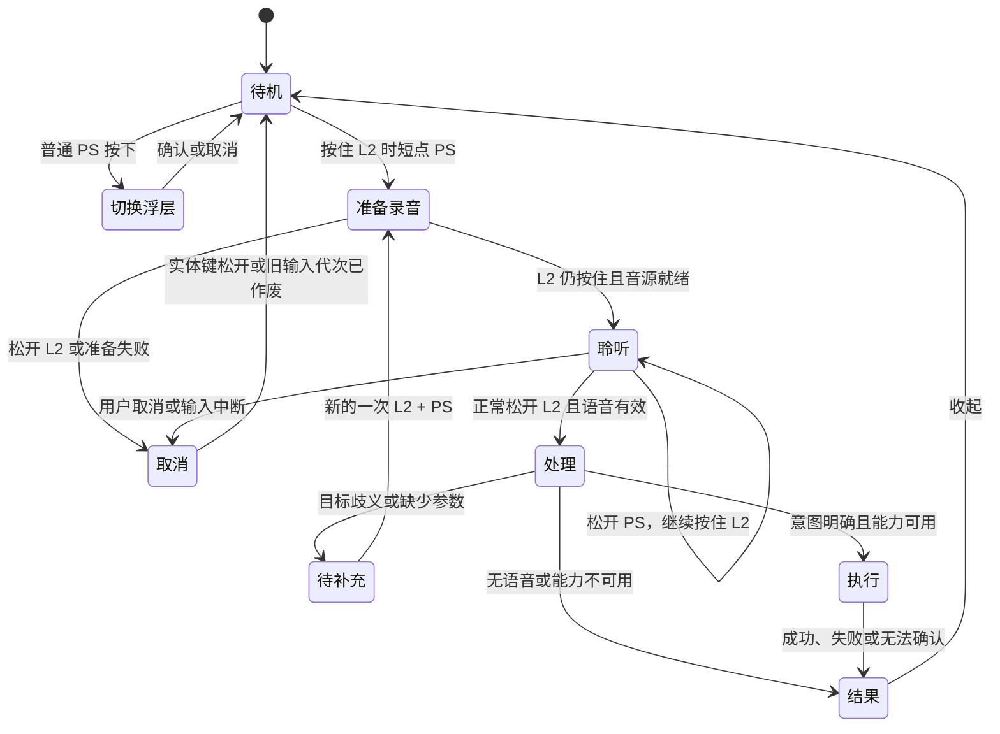

# Joy Harness 独立 AI 语音模式 Spec

状态：实现规格 v0.7 · 新增当前应用设置快捷键，登记能力共 17 类；本轮与历史验证记录见第 13 节

更新日期：2026-10-17

产品决策：用户；工程负责人、目标版本与发布日期待定

已有交付：独立 AI 语音服务、默认本地处理路线、可配置模型接口及首批登记能力已接入，v0.3 曾完成本机安装运行，v0.4 已替换按键入口并通过自动化复验。用户随后反馈当前环境基本功能已打通，例如打开微信输入法设置；该反馈不等于所有控制器连接、麦克风、模型与设备能力均已验收。

本次更新：在 v0.6 的 16 类能力上新增无参数 `open_current_app_settings`，通过一次固定 `Command-,` 请求打开当前应用设置，共 17 类能力。目标绑定主线程处理首次 L2 松开提交事件时的前台进程身份，追问沿用该目标；异步理解完成后，只有前台仍是同一进程且权限可用时才发送，不切回目标、不重复发送。结果仅确认快捷键已发送，不承诺设置窗口已打开。此前的系统外观及其他能力继续保留；设置仍为四组，每次只执行一项能力，结果保持约 3 秒。

## 1. 概览与价值判断

用户握着手柄时，先按住 L2，再短点 PS 并立即松开 PS；看到录音提示后继续按住 L2 说出操作，正常松开 L2 即可让 Joy Harness 理解并执行。例如：“打开微信输入法设置”。普通 PS 始终按下立即打开现有 Harness 切换浮层。交互不要求持续按住 PS；用户当前环境已有基本功能可用反馈，其他硬件与连接组合仍需分别验证。

这是 Joy Harness 自己的语音命令入口：录音状态、指令、能力调用和执行反馈由 Joy Harness 管理，在 Codex、Claude 或其他 Harness 下使用同一套体验。AI 后端可以替换，不要求把当前应用的聊天输入框当作执行入口。

这个方向的价值是减少“想到一个操作 → 找到应用和入口”的步骤。成败取决于三个结果：按键不误触、能完成明确的小任务、完成与失败都有可靠反馈。首版从已登记能力起步，再逐项添加；“打开微信输入法设置”应成为贯穿全链路的首个验收场景。

## 2. 已确认需求与建议方案

### 用户已确认

| 编号 | 决定 |
| --- | --- |
| C1 | 普通 PS 在按下时立即打开**现有 Harness 切换浮层**，无论 AI 语音是否启用；不是锁定或切换 L2 功能层。 |
| C2 | 先按住同一 DualSense 的物理 L2，再短点 PS；PS 按下即开始准备，立即松开 PS，看到聆听提示后再说话，不设长按阈值。 |
| C3 | 说话期间只需继续按住 L2；松开 PS 不提交，正常松开 L2 后自动发送，让 AI 执行操作。 |
| C4 | 支持逐步添加能力；“打开微信输入法设置”是明确提出的目标场景。 |
| C5 | 先完成 spec 的阶段已经结束；用户本轮明确授权开发，按本规格实现。 |
| C6 | 首版从已登记能力起步、逐项扩展，不在第一版提供任意应用的通用界面操作。 |
| C7 | 经路线讨论，默认采用 Apple 设备端语音识别 + 本机 OpenAI 兼容模型 API；云端／混合路线由用户主动选择，不自动降级。 |
| C8 | AI 语音默认关闭；开关仅决定 L2 + PS 是否进入语音，普通 PS 的即时行为始终不变。 |
| C9 | 映射模式且无切换浮层时，AI 开启后的 L2 + PS 为固定语音入口；AI 关闭时消费为空动作。两种状态均取消该次体感快速定位，不提供自定义组合用途。 |
| C10 | 用户实测 PS 长按会导致手柄关机；旧方案已被此硬件反馈取代，不再推荐持续按 PS 录音。 |
| C11 | 音量与亮度默认调整 10 个百分点，也可指定幅度或绝对百分比；亮度优先内建屏，没有内建屏才选择主屏。 |
| C12 | 每次只处理一项能力；多个请求要追问先做哪项。媒体播放／暂停只提供明确的切换，不把“暂停”直接解释成切换。 |
| C13 | “打开日间模式／打开夜间模式”只控制 macOS 浅色／深色；“跟随系统／自动外观”启用 macOS 按时间自动切换。Joy Harness 自身主题选项不变，原本跟随系统时自然变色。 |
| C14 | “打开当前应用的设置”发送一次固定 `Command-,`；目标取主线程处理首次 L2 松开提交事件时的前台应用，追问沿用首次目标，执行前必须仍为同一前台进程身份。前台变化、退出或权限不足时不发，不切回应用、不重复发送；设置窗口是否打开仍未确认。 |

### 首版实现参数与范围

- 无长按等待阈值；可信原始 HID 报告中的 PS 按下沿和同一手柄 L2 状态决定是否开始准备。录音持续期间要求 L2 仍按住且输入连续可信。
- 每次处理一个语音命令、执行一项登记能力；v0.7 共 17 类，详见第 7 节。原有应用、系统设置和微信输入法 3.0.0 设置入口保留。
- 使用系统默认麦克风；设置页显示当前输入，并通过“选择系统麦克风…”打开 macOS 声音设置。首版没有应用内独立音源选择器，不把手柄按键来源与麦克风绑定。
- 首版不建设常驻聊天窗口；需要追问时只保留当前命令的上下文。

待验证事项集中在第 11 节。本文区分已确定的实现契约与尚未完成的实机验收，不把功能开发完成等同于已发布。

## 3. 范围与当前基础

### 首版范围

1. 普通 PS 始终按下立即打开 Harness 浮层。AI 启用后，DualSense 按住 L2、短点 PS 发起独立语音，松开 L2 发送；AI 关闭时组合消费为空动作。
2. 从可用 macOS 输入设备录音，正常松开 L2 后自动完成识别、意图解析、能力执行和结果反馈。
3. 按已登记能力扩展；v0.7 支持第 7 节的 17 类操作。`open_current_app_settings` 仅向提交时捕获并在执行前核对的前台应用发送固定设置快捷键；`open_system_settings` 仅打开固定页面，`set_system_appearance` 独立修改 macOS 外观；微信输入法设置仍限定 3.0.0。硬件调节按设备实际支持返回结果。
4. 能力登记、可用性检查、必要参数、权限、执行与结果验证的统一约定，使后续可以增加应用能力。
5. 取消、无声音、歧义、未安装、权限缺失、服务不可用和输入中断的可理解反馈。

### 首版暂不包含，待需求明确后扩展

- 唤醒词、持续监听、无按键的自动录音，以及开放式常驻语音对话。
- 通用视觉电脑代理、模型任意生成并执行 shell、第三方能力市场。
- 发消息、删除文件、购买或账户修改等执行能力；以后按具体能力单独设计。
- 自动把语音注入当前 Codex/Claude 会话、改变已有按键自定义，或替换小米遥控器现有语音桥。
- DualSense 蓝牙麦克风协议开发；首版不承诺其他手柄和遥控器具备相同的组合入口。
- 通过语音修改 Joy Harness 自身主题偏好，或开关 Night Shift／夜览；系统外观能力仅覆盖 macOS 浅色、深色和自动模式。

### 实现基础与边界

| 已有基础 | 可复用范围与缺口 |
| --- | --- |
| PS 的 GameController/HID 两路输入 | 普通 PS 保留即时响应，组合会话独立跟踪 L2 的保持与释放；录音只信任未滤波、连续的原始 HID 报告。独立输入队列记录真实 L2 松开时刻，不使用主队列处理时间或原有 PS 松开滤波时间。 |
| L2 功能层与映射体系 | L2 + PS 按同一报告中的物理 L2 判定，不受自定义功能层键影响；开启 AI 时发起语音，关闭时空消费，不新增可配置组合动作。该次 MotionJump 始终取消，校准仍优先消费所选设备。 |
| `.pushToTalk` | 现有动作发送 Codex Micro `ACT10`，不是 Joy Harness 自己录音或调用 AI。需保留原有语义。 |
| 小米 BLE 语音与虚拟麦克风 | 向外部语音应用提供声音；现有链路不上传、不转写语音。不能视为现成的独立语音助手。 |
| Core Audio 输入与独立语音链 | 新增系统默认输入采集、内存录音、Apple 设备端识别及兼容模型 API；需要用户配置模型和权限，完整语音实机链路待验收。 |
| 应用启动与能力登记 | 新增已登记能力的解析、启停和结果核对；“已发起打开请求”不等于“设置窗口已打开”，无法观察到目标时返回未确认。 |

依据：[按键调研](../research/dualsense-ps-button-chords.md)、[ButtonBridge.swift](../../Sources/JoyHarness/ButtonBridge.swift)、[DualSenseHIDOutput.swift](../../Sources/JoyHarness/DualSenseHIDOutput.swift)、[ControllerMapping.swift](../../Sources/JoyHarness/ControllerMapping.swift)、[小米语音链路](../xiaomi-remote-voice.md)、[ControllerSupport.swift](../../Sources/JoyHarness/ControllerSupport.swift)、[JoyHarnessMain.swift](../../Sources/JoyHarness/JoyHarnessMain.swift)。功能集成与自动化测试分别记录；本文不声称完整按键、录音、模型和目标页面链路已经通过实机验收。

## 4. 按键交互

### 4.1 映射模式下的默认行为

普通 PS 的即时行为不受“启用 AI 语音”开关影响。映射模式且无切换浮层时，先按同一手柄的物理 L2 状态区分普通 PS 与组合；原生模式、已打开浮层及校准仍按第 4.3 节优先处理。

| 功能状态 | 普通 PS | 先按住 L2，再短点 PS |
| --- | --- | --- |
| AI 语音关闭／从未启用 | 按下立即打开 Harness 浮层，不录音。 | 独立识别并消费空动作，不切层、不录音。 |
| AI 语音已启用 | 按下立即打开 Harness 浮层，不录音。 | PS 按下即准备录音；立即松开 PS，继续按住 L2；正常松开 L2 发送。 |

功能已启用但服务、权限或音源暂不可用时，组合输入显示具体阻断，不回退为打开 Harness 浮层。升级不自动替用户开启 AI 语音；用户关闭时取消尚未提交的会话，普通 PS 时序始终不变。

| 输入 | 判定与动作 | 松开时 |
| --- | --- | --- |
| 普通 PS | PS 按下时同一手柄 L2 未按住，立即打开现有 Harness 切换浮层。 | 不补发动作，不升级为录音。 |
| AI 已启用的 L2 + PS | PS 按下时同一手柄的物理 L2 已达到约定阈值，即准备音源，无等待阈值。用户立即松开 PS，继续按住 L2；就绪后提示“正在聆听，松开 L2 发送”。 | PS 松开不结束录音；正常松开 L2 停止收音并提交一次，不再执行普通 PS。 |
| AI 已关闭的 L2 + PS | 锁定为组合输入，消费为空动作。 | L2 或 PS 松开都不补发普通 PS，也不开始语音。 |

L2 使用迟滞判定：启动组合要求 PS 按下的同一帧 L2 ≥ 0.55；会话期间轻微回落（例如 0.40）继续录音，只有 L2 ≤ 0.10 才视为释放并发送，恢复中立也采用此释放阈值。按下 PS 后再按 L2，不改变已经选择的普通 PS 分支；组合中先松 L2 也不会变成普通 PS，准备阶段松 L2 则取消。不同手柄的 L2 和 PS 不组成组合。组合一经识别便取消该次体感快速定位，松开 L2 不得同时提交语音与定位，也不得在 AI 关闭时补发定位。

首版组合入口要求恰好一只可唯一对应的 DualSense，以及持续的 USB 或蓝牙扩展 HID 报告。多台 DualSense 的 HID／GameController 身份尚不能可靠对应，或缺少可信原始报告时，不开放录音；保留普通 PS 的即时切换，不把另一只手柄的 L2 拼成组合。PS 按下事件送达时还需满足输入邮箱中的原始事件距捕获不超过 250 ms，且后续原始报告未显示 L2 已释放；过期或已释放时不补启录音，也不补发普通 PS。录音提交只接受输入源捕获的真实 L2 松开，不将输入断流、合成释放或主队列延迟解释为提交。中断后先确认中立状态，才接受下一次完整组合。

用户已报告持续按 PS 导致手柄关机。应用不承诺可以覆盖硬件行为；因此本交互只要求短点 PS，录音期间保持的是 L2。自动化测试不能证明新交互在真实 USB／蓝牙硬件上不会关机，该项尚待现场验收。

### 4.2 录音开始与提交语义

- 在满足条件的 L2 + PS 按下沿之前，不打开音频采集、不做预录缓存、不发送音频。没有 600 ms 等待阶段。
- PS 按下即准备音源；音源未就绪时显示“正在准备麦克风”，就绪后才提示可以说话。PS 应立即松开，L2 保持按住。可用轻触觉辅助，不能只靠声音或震动表达状态。
- 在准备阶段松开 L2、授权未完成或开始录音失败：结束本次尝试，不提交，也不补发普通 PS。准备阶段松开 PS 不取消，只要 L2 仍按住且输入可信。
- 用户正常松开 L2 即表示提交本次语音，不要求再按发送或确认转写。允许收齐松开前已采集但尚未交付的尾部缓冲，不继续收录松开后的新声音；裁剪以输入源捕获的 L2 松开时刻为准。
- 首版 L2 松开前音频只留在本地会话缓冲，不上传；取消录音不会产生云端提交。正常松开 L2 后，按明确配置的路线执行设备端识别，或向所选云端识别服务提交音频。
- “松开 L2 发送”表示立即进入处理流程，不表示语音识别、联网和执行已经完成。处理状态应立刻可见；无有效语音时不创建操作任务。
- 录音时按 B／Esc 或点击取消：停止并丢弃，随后 L2 或 PS 松开均不得发送。取消键需在浮层展示，手柄输入同时消费至松开，避免传给前台应用。

### 4.3 模式和浮层优先级

1. 原生手柄模式：沿用 PS 返回映射模式；该次按压被完整消费，不继续进入语音。下一次完整输入才适用普通 PS／组合规则。
2. Harness 切换浮层已打开：PS 沿用取消浮层的语义；即使按住 L2，该次输入也不开始录音。选择、确认、取消沿用现有交互。
3. 所选设备正在体感校准：保留校准对该设备输入的优先消费，不启动语音；取消或失败不改写原校准配置。
4. 映射模式、无切换浮层且未被校准消费：应用前台和后台均可使用语音。L2 + PS 取消该次 MotionJump；录音浮层不抢占当前应用焦点。
5. 从准备录音到提交，消费会干扰录音的普通映射输入，释放此前保持的映射输出；保留明确的取消入口。结束后必须等相关实体键回到松开状态才能恢复输出。
6. 切换展示设备不改变录音所属手柄。手动切换前台应用不自动取消录音；主线程处理首次 L2 松开提交事件时保存前台进程身份，追问沿用该结果，之后切换 Harness 不把已提交操作重定向到另一应用。当前应用设置能力在异步理解完成后重新核对前台身份；已切换、退出或无法核对时不发送快捷键，也不重新激活原目标。语音浮层保持非激活，不抢占目标应用焦点。
7. 按压途中开启 AI 语音不把已经消费的组合变成录音，下一次完整组合才生效；关闭时取消尚未提交的录音、消费本次输入，松开不补发切换或定位。已进入执行的命令按取消规则报告实际进度，不能承诺撤回已完成步骤。

## 5. 语音会话与界面反馈

上图描述 AI 语音已启用时普通映射模式的主流程；功能关闭时组合消费为空动作，原生模式、已打开切换浮层及所选设备校准的优先级按第 4 节处理。准备和聆听期间松开 PS 不结束会话，L2 才是保持与提交键。

### 独立、短暂的语音浮层

复用 [DESIGN.md](../../DESIGN.md) 的原生材质、语义色、图标加文字、键盘与 VoiceOver 规则。录音与执行状态放在独立浮层，不新增 Dashboard 任务列表、Codex 槽位进度或常驻聊天区。

| 状态 | 用户看到的内容 |
| --- | --- |
| 准备 | “正在准备麦克风”；有阻断则明确显示恢复入口。 |
| 聆听 | “正在聆听，松开 L2 发送”、实际音源、输入音量反馈、取消入口。 |
| 处理 | “正在识别…”或“正在理解…”；转写可用时展示本次指令。 |
| 执行 | 具体目标，例如“正在打开微信输入法设置…”。 |
| 待补充 | 一次只问会改变目标或参数的问题，提供选项；也可用新的一次 L2 + PS 作答或取消。 |
| 结果 | 已完成、失败、已取消或“已发起，但尚无法确认”；显示下一步，不把接纳请求当作完成。约 3 秒后自动收起并清空当前转写。 |

首版在松开 L2 后开始识别，不提供录音中的实时转写。默认路线使用 Apple 设备端识别；用户主动选择云端识别时，音频也只在松开 L2 后提交。用户无需等待转写完成才松开 L2。反馈采用简短文字，语音播报留待后续。

新增独立的“AI 语音”设置页，集中展示启用状态、系统默认音源、处理路线、服务配置与能力列表；与现有“遥控器麦克风”区分。用户从设置明确开启该功能，开启前说明“按住 L2、短点 PS 后立即松开 PS、继续按 L2 说话、松 L2 发送”；普通 PS 始终按下立即打开浮层。未开启时组合不能暗中开启或跳入配置；已开启但配置不完整时，组合显示设置入口。第一次启用需提供音源／服务配置和权限说明，不能在使用中假装已经开始收音。

## 6. 核心场景：打开微信输入法设置

**用户故事：**作为正在使用电脑的手柄用户，我希望说出“打开微信输入法设置”后直接到达对应设置窗口，以便不用寻找菜单和入口。

1. 用户按住 L2，短点 PS 并立即松开 PS，收到可说话的提示后继续按住 L2 讲出命令，正常松开 L2。
2. Joy Harness 取得转写，将“微信输入法设置”解析为输入法产品的设置入口。不能自动替换成微信聊天应用设置或 macOS 输入法列表。
3. 能力检查确认目标软件已安装、当前版本有已验证的入口，以及该入口需要的系统权限。
4. 通过适配器验证过的微信输入法 3.0.0 设置组件打开，不以聊天应用或系统输入法页面代替。
5. 观察到目标设置窗口／页面后，展示“已打开微信输入法设置”。仅找到进程或启动应用不算完成这个场景。

| 分支 | 预期表现 |
| --- | --- |
| 支持的版本且目标明确 | 松开后自动执行，不再询问是否打开。 |
| 只听到“打开微信设置”，确有多个候选目标 | 展示一次有区分度的选择，保留本条命令；不默认选择错误应用。 |
| 未安装微信输入法 | 说明未找到该软件，不下载、不安装、不打开相似应用来替代成功。 |
| 当前版本入口不受支持 | 说明具体限制；若只能打开应用，必须明确这是部分结果，不能报告已打开设置。 |
| 缺少执行所需权限 | 给出对应授权入口；本次不记作成功。授权完成后由用户明确重试，不暗中补执行旧指令。 |
| 动作已发起但无法观察结果 | 返回“尚无法确认”，保留实际尝试；不无限重试或伪造完成。 |

微信输入法设置适配器限定应用与设置组件版本均为 3.0.0，成功结果要求观察到目标设置窗口。用户已反馈当前环境基本语音功能打通，以此场景为例；其他应用版本、模型、麦克风及连接组合不沿用该验收结论。

## 7. 可扩展能力约定

AI 负责把自然语言转换成明确的能力和参数；Joy Harness 负责检查可用性、调度已登记的执行方式并核对结果。新增能力不应要求重新设计 PS 交互。

每个能力在注册表中说明以下内容，并通过结构化能力标识与字符串参数调用：

| 内容 | 用途 |
| --- | --- |
| 稳定标识、名称、说明与常用表达 | 让用户看懂，也让模型能选择正确能力。 |
| 参数及有效值 | 例如应用目标、设置页面；缺少参数时能够提出具体问题。 |
| 支持环境与可用条件 | 软件安装／版本、系统能力、当前权限；不可用项不得伪装为可执行。 |
| 行为及权限范围 | 区分打开界面与修改设置；“打开设置”本身不授权修改其中的选项。 |
| 执行器与验证方式 | 规定如何执行，什么可观察结果才算成功。 |
| 超时、取消、重试与重复调用规则 | 一次提交不重复执行；不确定已经产生效果时不盲目重试。 |
| 用户可见结果 | 完成、失败、部分完成、取消、无法确认，以及可理解的原因。 |

### v0.7 登记目录：17 类能力

| 设置分组 | 能力标识 | 参数及实际行为 |
| --- | --- | --- |
| 声音 | `adjust_volume` | `direction=up/down`；可选整数 `amount=1...100`，默认 10 个百分点，调大时解除静音。 |
| 声音 | `set_volume` | 整数 `percent=0...100`，设置绝对音量；大于 0 时解除静音。 |
| 声音 | `set_mute` | `muted=true/false`；取消静音保持原有音量，不自动调高。 |
| 声音 | `get_volume` | 无参数，读取系统输出音量及静音状态。 |
| 显示器 | `adjust_brightness` | `direction=up/down`；可选整数 `amount=1...100`，默认 10 个百分点。 |
| 显示器 | `set_brightness` | 整数 `percent=0...100`，设置绝对硬件亮度。 |
| 显示器 | `get_brightness` | 无参数，读取所选屏幕硬件亮度。 |
| 应用与系统 | `open_application` | `application` 为已安装应用名称或 bundle ID；重名时选择目标。 |
| 应用与系统 | `open_current_app_settings` | 无参数；对处理首次 L2 松开提交事件时保存、执行前仍处于前台的同一进程身份发送一次固定 `Command-,`。 |
| 应用与系统 | `open_system_settings` | `page` 只能为下列 27 个固定设置页面标识；仅打开页面。 |
| 应用与系统 | `open_wetype_settings` | 无参数；打开微信输入法 3.0.0 的设置组件。 |
| 应用与系统 | `open_folder` | `folder` 只能为下列 9 个固定位置，路径由本机 API 解析。 |
| 应用与系统 | `open_screenshot_tool` | 无参数；打开 macOS 截屏工具，由用户选择范围并完成截屏。 |
| 应用与系统 | `set_system_appearance` | `mode=light/dark/auto`；设置 macOS 浅色／深色／按时间自动切换，不修改 Joy Harness 自身主题偏好。 |
| 媒体与查询 | `media_control` | `action=play_pause/next/previous`；向系统发送播放／暂停切换、下一首或上一首。 |
| 媒体与查询 | `get_datetime` | 无参数；读取本机日期、星期、时间与当前时区。 |
| 媒体与查询 | `get_battery` | 无参数；读取 Mac 内置电池电量及供电状态，无内置电池时如实说明。 |

固定设置页为：蓝牙、声音、键盘、Wi-Fi、显示器、电池、网络、隐私与安全性、辅助功能、通知、专注模式、外观、桌面与程序坞、鼠标、触控板、日期与时间、语言与地区、储存空间、软件更新、登录项与扩展、通用、墙纸、屏幕使用时间、共享、打印机与扫描仪、用户与群组、锁定屏幕。标识及版本对应入口由 `AIVoiceSystemSettingsPage` 维护；打开 Wi-Fi 或蓝牙页面不代表开关相应功能。

当前应用设置能力 `open_current_app_settings` 不接受任何参数，模型不能指定 PID、bundle ID、应用名称或自定义快捷键。目标身份由 Joy Harness 在主线程处理首次 L2 松开提交事件时从前台应用捕获；异步识别及理解完成后，在发送前核对其仍是同一前台进程身份、进程仍存活且辅助功能权限可用。同名应用、同一 bundle 的新进程或复用 PID 不能代替原目标。任何检查失败均不发送、不切回应用，也不自动重试；取消、禁用和重复请求继续遵循统一派发限制。

目标捕获使用提交事件在主线程被处理时的当前前台状态；原始 HID 的硬件释放时间戳只用于音频裁剪，不用于还原该历史时刻的前台应用。追问属于同一条命令，沿用首次提交时保存的目标身份，首次未捕获到目标也保留该结果，不在回答追问时重新选定应用；只有开始新命令才重新捕获。

检查通过后只发送一次固定 `Command-,`。语音浮层保持非激活，不因展示或更新状态抢走前台焦点。发送完成只报告“已发送设置快捷键，尚未确认设置窗口是否打开”，结果属于未确认；部分应用不支持该快捷键。这个能力处理“打开当前应用的设置”，不替代 `open_system_settings` 的固定 macOS 页面，也不替代 `open_wetype_settings` 的微信输入法专用设置组件和窗口验证。

系统外观表达映射固定为：“打开日间模式” → `light`，“打开夜间模式” → `dark`，“跟随系统／自动外观” → `auto`。浅色或深色操作先关闭系统自动外观，再应用指定颜色；自动操作只启用 macOS 按时间自动切换，不强指定当下颜色。执行后读回实际状态：手动模式须同时确认自动已关闭且颜色匹配；自动模式须确认自动已启用，不因当前仍是浅色或深色而误报失败。无法读取或状态不符时不报告成功。

该能力只控制 macOS 系统外观。Joy Harness 自身“通用 → 外观”选项保持原值，原本跟随系统时自然随系统变色。“打开外观设置”仍映射为 `open_system_settings(page=appearance)`，仅打开页面；Night Shift／夜览与硬件亮度分别处理，不得把这些请求静默改成系统外观修改。

执行器动态加载本机 SkyLight 外观接口，缺少库、符号或读取到无效状态时明确失败，不静默改用任意脚本或修改应用主题。设置接口没有成功返回码，必须分别读取自动标志与当前浅色／深色状态核对；读回不符或部分写入失败时返回未确认，不重复写入。

固定文件夹为：`home` 个人文件夹、`desktop` 桌面、`downloads` 下载、`documents` 文稿、`applications` 应用程序、`utilities` 系统实用工具、`pictures` 图片、`movies` 影片、`music` 音乐。它们不接受路径、网址或文件名参数。

音量与亮度的“调整 10 个百分点”和“设为 10%”分别表示相对变化与绝对值。硬件亮度优先选择内建屏，无内建屏时选择主屏，不用于键盘背光或光缝亮度，也不选择其他指定显示器。优先使用 DisplayServices，外接屏不可用时尝试 DDC/CI；DDC 仅支持单块物理外接屏与唯一外接控制通道，不能依据枚举顺序猜测多屏对应关系。每次传输前检查显示器身份，等待可取消且不阻塞主线程；严格校验响应及修改后的读回值。Redmi 27 NU 已验证真实亮度读取，写入效果仍待实机试用。

媒体 `play_pause` 是切换动作，执行器无法确认当前播放状态。用户只说“暂停”或“播放”时，说明目前只能切换并追问；即使模型误返回切换动作，会话仍根据实际转写显示固定的“切换播放／暂停”按钮。点选后只执行一次，或在下一次语音中明确说“切换播放暂停”直接执行；单说“确认”或模型声称用户已确认不能跳过该检查。发送媒体按键、打开文件夹或截屏工具被系统接受后，当前执行器返回“已发送／已请求，尚无法确认”，不冒充播放状态改变、Finder 窗口出现或截图已保存。电池查询只读 Mac 内置电池，不把 UPS、手柄或耳机电量当作电脑电量。

设置按四组列出全部能力，每项独立开关并显示常用表达。目标明确、参数有效且能力已启用时直接执行；缺少无默认值的参数、目标歧义或一句话包含多个请求时先追问。每个会话只派发一项能力，同一请求 ID 不重复执行；禁用项在派发前重新检查。

模型输出只能选择可用能力，不能成为任意代码执行入口；从应用界面读取的文字作为待观察数据，不得替代用户命令或扩大能力权限。

## 8. 音频、模型与生命周期

### 已确定的默认路线

输入判定 → 系统默认麦克风录音 → Apple 设备端语音识别 → 本机 OpenAI 兼容模型 API → 已登记能力执行 → 结果核对。

AI 语音默认关闭；处理路线默认设为“本地”。本地识别使用 Apple Speech 并要求 `requiresOnDeviceRecognition = true`。设备、系统或所选语言不支持设备端识别时，明确显示原因，不能自动请求 Apple 云端识别，也不能把本地失败改为云端路线。

模型服务由用户提供并启动。Joy Harness 不内置或自动下载模型，不复用 Codex／Claude 登录态。理解指令通过 OpenAI Chat Completions 兼容接口请求，模型需按约定返回能力与参数 JSON。具体模型是否正确遵守格式、中文指令效果和响应速度需要验证；“兼容接口”不代表任意模型都已经通过验收。

| 配置项 | 默认值与约定 |
| --- | --- |
| 启用 AI 语音 | 关闭；用户明确启用后才开放 L2 + PS 语音，普通 PS 始终即时响应。 |
| 处理路线 | 本地：Apple 设备端识别 + 本机模型 API。 |
| API Base URL | 示例默认值 `http://127.0.0.1:1234/v1`；可修改，不表示该端口已有服务。 |
| 模型名称 | 默认空；未填写时阻止录音任务准备和服务请求，不猜测模型名。 |
| API Key | 可留空；服务需要鉴权时由用户填写，保存到系统钥匙串并绑定具体服务地址。 |
| 识别语言 | 默认 `zh-CN`，可选择 `en-US`；以设备端可用性检查为准。 |

本地路线只接受 `localhost`、`127.0.0.1`、`::1` 回环地址。但“请求发往本机”不证明“全部处理留在本机”：用户配置的本地网关／代理可能继续转发到云端。只有该服务本身也在本地运行模型、不转发请求，才符合全本地数据边界；应用不能替本地服务保证数据处理方式。

### 可选路线及数据去向

| 路线 | 识别与理解 | 正常松开 L2 后的数据去向 |
| --- | --- | --- |
| 本地（默认） | Apple 设备端识别 → 本机兼容模型 API。 | 原始音频不由 Joy Harness 发往服务端；转写、本条必要上下文及能力描述发往配置的本机地址。本地中继是否继续上云取决于用户配置。 |
| 混合（主动选择） | Apple 设备端识别 → 用户指定的模型服务。 | 音频留在本机，转写与必要能力上下文发送到指定模型服务。 |
| 云端（主动选择） | 用户指定的 `audio/transcriptions` 兼容服务 → 用户指定模型服务。 | 松开 L2 后上传本次音频至识别服务，再把转写和必要上下文发往模型服务；两者分别配置地址、模型和可选密钥。 |

不自动切换路线，不在失败后静默请求其他提供方。非回环服务使用 HTTPS；不跟随将请求或凭据转发到其他地址的服务重定向。用户决定是否配置云端端点及其账户、费用；客户端不保存不等于服务端不保存，服务方的留存政策由所选服务决定。

只发送本条指令、追问所需的当前命令上下文和已启用能力描述。首版不默认发送屏幕截图、整个可访问性树或其他 Harness 的聊天内容。模型输出经过能力及参数校验后才能执行，不能直接执行模型生成的代码。

### 音源与数据生命周期

首版使用系统默认麦克风。设置页显示当前系统输入，“选择系统麦克风…”打开 macOS 声音设置；应用不提供独立设备选择器，也不主动修改系统默认输入。每次录音开始后，音频配置或系统输入发生变化即取消本次录音，不静默切换设备继续录制。

DualSense 蓝牙连接只提供按键触发，语音来自系统默认输入；首版不实现手柄私有蓝牙音频协议。USB DualSense 只有在系统实际提供音频输入、且用户选为默认输入时才用于录音，不能仅凭名称认定音频可用。[已有麦克风调研](../research/dualsense-wireless-microphone.md)

Joy Harness 录音需要麦克风权限；本地和混合路线还需 Speech 语音识别权限。辅助功能权限仅用于实际需要的键鼠操作或目标窗口核对；配置或授权不完整时显示具体恢复入口。权限完成后需要用户重新发起按压，不自动补执行已取消命令。

原始音频只在当前会话的必要内存缓冲中存在，不写录音文件；不保存历史转写。松开 L2 前不上传音频，取消后丢弃未提交内容。首版在松开 L2 后才识别，不提供持续监听或预录。

### 中断、取消与并发

- 每次完整 L2 + PS 组合对应一个唯一语音会话，正常松开 L2 最多提交一次；迟到的第二路报告和旧模型结果不能启动新会话或再次执行。
- 控制器断连、输入状态失去可信度、锁屏／睡眠、应用退出、转入原生模式或音源失效：录音取消且不提交。合成释放不能被当作用户“松开 L2 发送”。
- 断连或输入代次失效时直接终结旧会话，不等待可能永远不会到达的旧松开事件；重新连接或恢复输入后，先确认新代次处于中立状态，再接受新的完整组合。旧设备的迟到报告不能恢复或提交已取消录音。
- 首版最长录音 60 秒，到限提示并停止，按取消处理，不自动提交；后续可根据体验调整。麦克风准备、识别、模型和执行分别需要有限等待时间，具体预算由选型测试确定。
- 在识别或理解阶段取消，应停止继续派发能力；已执行到系统／应用的动作不能承诺回滚。执行中的取消只阻止尚未开始的步骤，并报告已经发生的结果。
- 首版同一时间执行一条命令；忙碌时再次输入 L2 + PS 保持上一条命令的处理状态，不录音、不排队、不把旧命令暗中取消。普通 PS 切换 Harness 不改变旧命令的目标。
- 在“待补充”状态，新一次 L2 + PS 仅回答当前问题；用户取消后，下次语音才作为新命令。采用明确的上下文范围，避免把旧回答带进新任务。
- 网络或服务恢复后不自动重放已提交的系统操作；用户重试时也必须考虑上一次是否已经执行，不能用“没收到结果”推断“没有效果”。

## 9. 用户故事与验收

| 编号 | 用户故事与价值 | 可观察的验收结果 |
| --- | --- | --- |
| A1 | 我希望普通 PS 即时切换 Harness，保留熟悉的选择入口。 | AI 开关两种状态均在 PS 按下时打开浮层一次；松开不补发；全过程无录音、无音频上传。 |
| A2 | 我希望按住 L2 说、松开 L2 发送，手不离开控制器。 | 先按住 L2、短点 PS 即准备，无长按阈值；松 PS 不结束，音源就绪有提示；正常松 L2 只提交一次，空白语音不执行。 |
| A3 | 我希望不同按法互不干扰。 | L2 + PS 不触发普通 PS，并取消该次 MotionJump；松开顺序不改判，只有正常松 L2 可提交；双路迟到不重复录音或执行，校准优先级保留。 |
| A4 | 我希望说出“打开微信输入法设置”后到达正确入口。 | 在声明支持的环境到达目标设置窗口并验证；转写、目标解析和动作结果可区分；启动了应用不能冒充设置页打开。 |
| A5 | 我希望失败时知道原因，而不是再猜一次。 | 未安装、权限拒绝、无音源、入口不支持、超时分别反馈；取消／断连／锁屏不提交半段语音。 |
| A6 | 我希望能添加新能力，而不更换交互方式。 | 新增一个符合能力约定的适配器，可通过同一语音流程发现、调用和验证；禁用后不会继续派发。 |
| A7 | 我希望后台使用也有明确反馈。 | 在支持的 USB／蓝牙连接及前后台矩阵验证；原生模式、已开切换浮层保持约定优先级，录音浮层不抢焦点。 |
| A8 | 我希望新功能不打断已有语音工作流。 | 原有 `.pushToTalk`、小米虚拟麦克风和用户映射保留；新录音不会同时触发外部语音快捷键。 |
| A9 | 我希望明确启用后才开放语音，同时保留普通 PS 的肌肉记忆。 | 默认关闭时组合空消费，开启后才允许语音；普通 PS 在开关两种状态下始终即时打开浮层。准备或录音中关闭会取消，后续松开不补提交。 |
| A10 | 我希望录音不导致手柄关机。 | 按连接和型号验证 L2 保持、PS 短点时的持续连接；当前用户环境的基本可用反馈不替代完整 USB／蓝牙矩阵。 |
| A11 | 我希望一句话调声音或亮度。 | 未指定幅度时调整 10 个百分点；绝对百分比不混为相对值；调大音量与设置正音量解除静音，单独取消静音不提高音量。 |
| A12 | 我希望看到真实的硬件结果。 | 亮度内建屏优先，否则主屏；不支持的设备提示原因。外接 DDC 必须唯一匹配硬件，只有读回符合目标才报告修改成功。 |
| A13 | 我希望媒体操作不会反向执行。 | “暂停／播放”不直接改为切换；明确切换、下一首、上一首只发送一次媒体事件，结果保持未确认。 |
| A14 | 我希望常用入口易找到。 | 27 个固定设置页与 9 个固定文件夹按白名单解析；截屏指令只打开系统工具。 |
| A15 | 我希望一次只执行我选定的操作。 | 多项请求追问先做哪项；逐项禁用能力后不派发，取消或重复请求不再执行。 |
| A16 | 我希望查询结果准确且能看清。 | 日期时间采用本机时区；Mac 无内置电池和读取失败分别反馈；结果保持约 3 秒。 |
| A17 | 我希望用语音切换 macOS 外观。 | 日间／夜间先关闭自动再设为浅色／深色；跟随系统只启用系统自动模式，读回状态符合请求才成功。Joy Harness 自身主题偏好保持不变；Night Shift／夜览、硬件亮度及打开外观设置页不混淆。 |
| A18 | 我希望打开提交时正在使用的应用设置，避免发到别的应用。 | 目标在主线程处理首次 L2 松开提交事件时捕获，追问保留首次目标（包括未捕获到目标的结果）；模型指定目标参数被拒绝。异步理解完成后仅同一前台进程、目标存活且辅助功能权限可用时发送一次 `Command-,`；切换、退出、身份变化、权限不足、取消、禁用或重复请求不发送，不切回目标。浮层不抢焦点；发送后返回未确认，不冒充设置窗口已打开。 |

A1、A3 与 A9 覆盖 AI 开关两种状态；A2 与 A10 在 AI 已开启且输入可靠时验证。输入验证要覆盖 PS 立即松开后继续录音、准备中松 L2、L2 从 0.55 以上回落至 0.40 不提交及降至 0.10 才释放、超过 250 ms 的过期 PS 按下事件与随后已释放的输入不补启动、真实 L2 松开时刻与主队列处理延迟、原有 PS 松开滤波、报告丢失、双路乱序、多控制器、音源准备失败及组合中切换功能开关。自动化测试验证这些外部行为，避免只复述实现条件的同义反复测试（No tautological tests）；真实 USB／蓝牙连接、输入延迟、音源和端到端体验仍需实机验证。

### 成功指标

记录普通 PS／L2 + PS 误判率、从 L2 物理松开到“处理中”可见的延迟、从提交到经过验证的目标结果的延迟、首批能力完成率，以及误执行／重复执行数量。当前无测量基线，数值目标与观察周期待实机和服务选型后确定；不能将预期时延或预期不关机表现写成已有性能。

## 10. 与领域及设计约定的关系

本轮在实现功能的同时同步以下契约，保留已有体感校准、Harness、遥控器和 Codex Micro 工作流：

| 文档／约定 | 本轮调整 |
| --- | --- |
| [CONTEXT.md](../../CONTEXT.md)：PS 与领域边界。 | 普通 DualSense PS 始终即时切换；L2 + PS 在 AI 开启时发起语音、松 L2 发送，关闭时空消费并取消该次 MotionJump；新增独立语音会话与已登记本地能力执行边界，继续不拥有外部 Harness 的任务和权限策略。 |
| 原生模式、Harness 浮层与体感校准。 | 保留 PS 返回映射、取消已有浮层及所选设备校准的优先消费，不在同次输入中开始语音。 |
| [DESIGN.md](../../DESIGN.md)：设置与反馈。 | 新增 AI 语音设置页和独立语音浮层；Dashboard 不增加任务列表或任务进度。 |
| README、控制器映射与权限说明。 | 区分 Codex Micro 按住说话、小米音频桥与 Joy Harness 独立 AI 语音；列明默认路线、配置、系统默认音源及限制。 |

实现状态和实机验证结果分别记录。文档中的输入与数据边界是验收要求，不能把已提交代码或已通过自动化测试写成已发布、离线全链路已验证。

## 11. 决策记录与待验证项

| 编号 | 问题／决定 | 状态 | 下一检查点 |
| --- | --- | --- | --- |
| D1 | “切换层”指现有 Harness 切换浮层。 | 用户已确认。 | 普通 PS 按下立即打开该浮层。 |
| D2 | 废除 PS 长按语音，改用按住 L2、短点 PS 开始、松 L2 发送。 | 用户实测 PS 长按会关机，v0.4 据此替换旧决定。 | 新组合 USB／蓝牙不关机、PS 松开不中断与主队列阻塞验证。 |
| D3 | 从已登记能力开始扩展，不做通用界面代理。 | v0.5 从 3 类扩至 15 类。 | 验证参数范围、启停、重复请求与设备不支持分支。 |
| D4 | 默认 Apple 设备端识别 + 可配置本机 OpenAI 兼容 API；云端／混合可选。 | 用户本轮已确认。 | 本机识别可用性、所选模型格式及延迟。 |
| D5 | Base URL／模型／API Key 可配置，Key 可空；模型默认空阻止请求。 | 已纳入实现。 | 完整配置、缺失配置、鉴权及错误端点测试。 |
| D6 | 默认关闭 AI 语音；普通 PS 不随开关改变，始终按下即时响应。 | v0.4 决定。 | 开关两种状态、升级默认值与取消测试。 |
| D7 | L2 + PS 开启时进入语音，关闭时空消费；均取消该次 MotionJump，保留校准优先级。 | v0.4 取代旧“始终留空”决定。 | 两种开关状态、准备中松 L2、校准与多设备隔离。 |
| D8 | 无长按等待阈值；60 秒录音上限、忙碌不排队、原生模式返回映射不变。 | v0.4 废除旧 600 ms 阈值。 | 验证 L2 释放边界与中断取消，不改变数据路线。 |
| D9 | 用户已明确“开发吧”，后续反馈基本语音功能打通。 | 当前用户环境已有可用反馈。 | 本轮扩展统一构建与自动化测试；具体设备分别验证。 |
| D10 | 音量／亮度默认 10 个百分点，播放／暂停仅明确切换；每次一项能力。 | v0.5 契约。 | 参数、媒体语义及多请求追问。 |
| D11 | 外接屏亮度需设备适配；当前 Redmi 使用 DDC 路线。 | 已实现单外接屏支持，真实读取已核验。 | 真实写入与读回效果、其他显示器及连接方式验证。 |
| D12 | 新增 macOS 系统外观能力，共 16 类；不修改 Joy Harness 自身主题。 | 已实现；应用与系统组更名，仍四组。 | CI、只读环境验证与安装结果见第 13 节；真实切换及其他应用重绘待试用。 |
| D13 | 新增无参数当前应用设置能力，共 17 类；固定 `Command-,` 仅发给提交时捕获且执行前仍处于前台的同一进程。 | 已实现；语音专项回归通过，验证详情见第 13 节。 | 目标捕获、前台变化／退出、权限、参数拒绝、取消／禁用／去重、追问保留目标与非激活浮层；发送结果保持未确认。 |

尚待验证：v0.7 真实语音链路中的浮层焦点及不同应用快捷键响应；v0.6 系统外观的真实写入、系统通知与其他应用重绘；Redmi 外接屏 DDC 实际写入效果及其他显示器支持；具体音频输出设备写入、系统设置页打开与媒体播放器响应；完整 USB／蓝牙、多 DualSense、音源、语言与模型组合。本轮验证及 v0.6、v0.5 历史结果分别记录于第 13 节；用户当前环境已反馈基本语音功能打通，未验证的型号、模型和应用版本仍分别记录。

## 12. 关联资料

- [DualSense PS 组合键可行性](../research/dualsense-ps-button-chords.md)
- [DualSense 麦克风现有调查](../research/dualsense-wireless-microphone.md)
- [小米遥控器现有语音链路](../xiaomi-remote-voice.md)
- [领域约定](../../CONTEXT.md) · [设计规范](../../DESIGN.md) · [控制器映射](../controller-mappings.md)

初稿使用技能：`prd`、`grilling`。后续依据用户决定持续修订：开发已获授权，默认路线已选定，v0.4 废除 PS 长按入口，v0.5 扩至 15 类登记能力，v0.6 增加 macOS 系统外观至 16 类，v0.7 增加当前应用设置至 17 类。技能改进建议仍为同步按压时序、启用边界与验收标准，并及时把后续决定回写到状态和决策表。本次文档修订未使用技能，不修改技能文件。

## 13. 验证记录与版本边界（2026-10-17）

### v0.7 本轮记录

新增 `open_current_app_settings` 的 20 项测试，覆盖处理提交事件时捕获目标、模型等待期间不改目标、新命令重新捕获、追问保留原目标（包括 nil）、同一前台进程核对、退出或 PID 复用、权限缺失／撤销、构造失败、取消、禁用、重复请求与拒绝模型目标参数。测试构造并检查真实 CGEvent 的按下／松开、逗号键码、仅 Command 修饰键与非自动重复，但使用注入发送器，没有向真实应用发送快捷键。语音专项 `swift test --no-parallel --filter AIVoice`：119 项、13 个测试集通过。

第一轮 `task ci` 完整通过（584 项 Swift、52 项 Python、驱动、ShellCheck、Release 构建）。补充追问回归及工作区并行改动后，最终全量 `swift test --no-parallel` 运行 595 项、52 个测试集，语音全部通过；2 项 Joy-Con 既有测试仍产生 7 条断言失败：`leftVerticalDefaultsRoutePhysicalButtonsAndReleaseTheirOriginalActions` 与 `verticalZLModifierExposesCombinationsAndRoutesHIDPresses`。失败涉及并行变化的功能键加速／滚动预期，未在本次语音改动中修改。独立运行 52 项 Python、麦克风驱动、ShellCheck 与 Release 构建均通过；不将最终全量检查写成通过。

`bash scripts/build_and_run.sh --verify` 完成签名、权限／资源验证并更新启动 `/Applications/Joy Harness.app`。原生 AI 语音设置页确认“打开当前应用的设置”开关已启用、两条示例及使用说明存在，滚动后的实际界面排版正常。检查未修改用户模型、密钥、主题或能力开关，未录制语音或向真实应用发送设置快捷键。

浮层源码保持 `.nonactivatingPanel`，不能成为 key/main window；实际语音链路的焦点行为和不同应用对 `Command-,` 的响应仍待试用。发送完成仍为 `.unconfirmed`，不能将快捷键已发送写成窗口已确认打开。

### v0.6 已有记录（保留）

新增 `set_system_appearance(mode=light/dark/auto)` 的 7 项定向测试通过，覆盖模型参数到执行器分发、手动关闭自动的顺序、自动不指定颜色、读回不符、部分写入失败、禁用、重复请求和取消。测试使用注入环境，没有改动真实系统外观。完整 `task ci` 通过：565 项 Swift 测试、52 项 Python 测试、麦克风驱动检查、ShellCheck 和 Release 构建。

实际环境适配器独立编译（warnings-as-errors）及只读检查通过，返回 `isAutomatic=true, isDark=true`；未调用真实 setter，系统通知和其他应用重绘仍待实际语音试用。

`bash scripts/build_and_run.sh --verify` 完成签名、打包验证并更新启动 `/Applications/Joy Harness.app`。原生 AI 语音设置页已确认“macOS 日间／夜间／自动外观”开关与示例、三种指令使用说明存在，滚动排版正常；检查没有改动系统外观、Joy Harness 自身主题、模型或能力开关。

### v0.5 已有记录（保留）

用户反馈当前环境的基本语音功能已打通，例如打开微信输入法设置。此为用户当前环境反馈，不扩展为所有能力、显示器或连接方式通过实机验收。

15 类能力、四组设置开关与示例已纳入本轮实现。`task ci` 通过：558 项 Swift 测试、52 项 Python 测试、麦克风驱动检查、ShellCheck 与 Release 构建。测试覆盖参数范围、相对／绝对值、派发前启停、重复请求、取消、媒体误映射确认、声道平衡、硬件读回不一致以及 DDC 真机报文夹具。

使用实际系统控制源文件的独立只读检查返回：系统默认输出音量 15%、未静音；Redmi 27 NU 硬件亮度 60%。未执行真实音量写入或 Set VCP，不将读取成功视为硬件写入验收。27 个系统设置入口标识已对照本机 ExtensionKit Info.plist 存在性核查；截屏工具使用本机已确认的 `com.apple.screenshot.launcher`，这些静态核查不代表所有窗口已端到端验收。

`bash scripts/build_and_run.sh --verify` 已通过签名、打包验证并安装启动 `/Applications/Joy Harness.app`。原生设置界面检查确认声音、显示器、应用与系统入口、媒体与查询四组及 15 个开关和示例存在，滚动布局正常；检查过程中未修改 AI 开关、模型配置或能力开关。结果自动收起维持 3 秒。

### v0.4 与更早版本记录（保留）

v0.4 自动化复验：工作区 `task ci` 通过，共 512 项 Swift 测试（43 个测试集）、52 项 Python 测试、麦克风驱动测试、ShellCheck 和 release 构建。输入回归覆盖 PS 点按后继续录音、L2 迟滞与真实释放时间、重复输入、取消与停流、交付前时效复查，以及 MotionJump 双源乱序和 HID 中断恢复。若 GameController 丢失了本次 L2 按下，体感恢复会保守消费下一次完整 L2 周期。此结果不替代真实手柄、麦克风与模型的端到端验收。

v0.4 安装与界面复验：`bash scripts/build_and_run.sh --verify` 完成签名、资源与权限校验，并成功安装启动 `/Applications/Joy Harness.app`。通过实际设置窗口确认“按住 L2、点 PS、松开 L2 发送”的说明完整可见；本轮未改动用户已配置的开关、音源或模型服务，也未录制真实麦克风或调用模型。

以下安装、界面及能力结果来自 v0.3，作为已有服务的验证记录保留：

- v0.3 工作区 `task ci` 曾通过：486 项 Swift 测试、52 项 Python 测试、麦克风驱动测试、ShellCheck 和 release 构建。新增回归覆盖真实释放时间裁剪、取消晚回调、去重、模拟输入回中、凭据隔离与打包权限。
- `scripts/build_and_run.sh --verify` 完成签名、打包资源及权限校验，并安装运行 `/Applications/Joy Harness.app`。最终设置布局另行重建并通过真实界面检查，功能仍保持默认关闭，模型与密钥未代填。
- 微信输入法 3.0.0 能力已直接实测：启动前设置组件未运行，执行后确认设置专用进程的可见窗口，返回成功。未修改任何输入法设置。
- 冷启动检查发现旧遥控器虚拟麦克风预热可能同步等待系统授权；现已在后端创建前检查权限，未授权时给出明确入口，不在启动时隐式弹出授权或阻塞界面。实际重启与设置页访问已验证。
- 音频保留“按输入源的真实释放时间先裁原始 PCM、再重采样”契约；v0.4 的释放源改为 L2。时间轴异常或超过 64 MiB 缓存上限时取消，录音期间的摇杆和触摸输入需回中／离触后恢复；新 L2 释放链路需重新验证。
- 尚未实测用户的完整按住说话 → Apple 本地识别 → 本机兼容模型 → 能力执行链路。没有录制真实麦克风或调用真实模型服务；USB／蓝牙手感、语音识别资源与具体模型兼容性仍需现场验收。
- v0.4 硬件反馈：用户实测持续按 PS 导致手柄关机，旧 PS 长按入口废除。新入口已完成上述自动化复验；真实 USB／蓝牙硬件的持续连接、手感及完整语音链路仍待验收。
